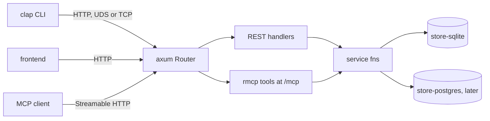

# sc-runtime Architecture

**ID Range:** ADR-RUN-0001 through ADR-RUN-0402  
**Status:** Draft  
**Created:** 2026-09-19  
**Last Updated:** 2026-09-19  
**Owner:** sc-runtime maintainers  

---

Repo-level architecture and ADRs for `sc-runtime`, extracted from
[`sc-runtime-design.md`](sc-runtime-design.md). Requirements are in
[`requirements.md`](requirements.md). Crate-level architecture and ADRs live in
`docs/<crate>/architecture.md`:
[sc-config](sc-config/architecture.md),
[sc-transport](sc-transport/architecture.md),
[sc-command](sc-command/architecture.md),
[sc-runtime](sc-runtime/architecture.md).

ADR entries follow the shared SC requirement and ADR templates.

Decided in this document: ADRs live in the architecture files; the design's
`docs/adr/` directory is not used; the design's gate "ADR amendments written
and accepted" is met by ADR-RUN-0001 and ADR-RUN-0201 being Active.

An ADR whose status field reads Active or Approved is binding on every plan,
change and fix. An ADR whose status field reads Proposed is not binding, and
no sprint may depend on it, until it is made Active. ADR ids have the form
`ADR-<DOMAIN>-nnnn`, where the domain is `RUN` (this file), `CFG`, `TRN`,
`CMD` or `RT` (the crate files).

## System shape

**Product framing:** sc-runtime is a **published scaffolding framework** for
many independent consumer projects (agent-first JSON CLI, mandatory actionable
errors, MCP on the same router, SQLite locally with a path to additional sqlx
store backends). See [`framework-charter.md`](framework-charter.md).

`sc-runtime` produces two kinds of thing: four library crates that are
published and versioned, and a template that is rendered once into a project
and then belongs to that project.

| Layer | What it holds | Owner | Lives in |
|---|---|---|---|
| Standalone crates | config loading; listener and client connector; response envelope | this repo, published | `crates/sc-config`, `crates/sc-transport`, `crates/sc-command` |
| Assembly crate | singleton lock, router merge, serve, graceful shutdown, test fixture | this repo, published | `crates/sc-runtime` |
| Application layer | operations, routes, MCP tools, CLI commands, stores, schemas | the generated project | rendered from `template/` |
| Generation tooling | options contract, fixtures, driver, wizard | this repo, not published | `wizard/`, `scripts/`, `tests/unit/` |

The dividing rule is upgradeability: generated code cannot be upgraded after
birth, a dependency can. So anything that should improve across all projects is
in a crate, and anything a project will want to edit is in the template.

## Runtime architecture

One daemon process owns the stores, and every client reaches it over HTTP
through one Axum router. REST handlers and MCP tools are both thin: each
deserialises into an `api-types` struct and calls the same async service
function, which is the only code path to SQL.



Request path for one operation: the CLI posts `CreateWidget` JSON to
`/ops/widget.create`; the handler calls `service::create_widget(stores,
input)`; the service function runs a checked sqlx query in the store crate; the
`Result<Widget, OpError>` becomes an envelope on the way out. An MCP
`tools/call` for `widget_create` joins the same path at the service function,
with the same `CreateWidget` struct as its input schema.

Daemon start-up, performed by `sc_runtime::Daemon::builder()` in a fixed order:
take the config the project already loaded; resolve the instance root and take
the `daemon.lock` singleton; call the project's stores closure; merge the
project's router with the OpenAPI document route, a health route and the MCP
service; bind the listener through `sc-transport` and serve until SIGINT or
SIGTERM. The project's `main.rs` loads config with `sc-config` and initialises
`sc-observability` itself before calling the builder.

`<instance-root>` is the per-application, per-user directory resolved by
sc-transport, or an explicitly supplied path; its default location is
undecided ([REQ-TRN-0002](sc-transport/requirements.md)). There is one
`axum::Router`, served unchanged on the one listener `run()` binds. v0.1 binds
exactly one listener. `TransportConfig` is `#[non_exhaustive]` and has no
`additional_endpoints` field
([REQ-RT-0001](sc-runtime/requirements.md)).

## Crate graph

This section mirrors [REQ-RUN-0005](requirements.md), which owns the
workspace-internal edges and the forbidden edges.

| Crate | Workspace crates it depends on | Forbidden edges (`forbidden_edges`) |
|---|---|---|
| `sc-config` | none | `sc-transport`, `sc-command`, `sc-runtime`, `sc-runtime-db-sqlite`, `sc-cron`, `sc-observability`, `sc-observability-otlp`, `sc-observability-types`, `tokio` |
| `sc-transport` | none | `sc-config`, `sc-command`, `sc-runtime`, `sc-runtime-db-sqlite`, `sc-cron`, `sc-observability`, `sc-observability-otlp`, `sc-observability-types` |
| `sc-command` | none | `sc-config`, `sc-transport`, `sc-runtime`, `sc-runtime-db-sqlite`, `sc-cron`, `sc-observability`, `sc-observability-otlp` |
| `sc-runtime` | MUST: `sc-transport` with its `server` cargo feature, `sc-command` with its `server` cargo feature. The edge `sc-runtime` -> `sc-config` is absent | `sc-runtime-db-sqlite`, `sc-cron`, `sqlx` (cargo tree; not a workspace member), `sc-observability`, `sc-observability-otlp` |
| `sc-runtime-db-sqlite` | none | `sc-config`, `sc-transport`, `sc-command`, `sc-runtime`, `sc-cron`. `sqlx` is absent and is checked with `cargo tree`, because it is not a workspace member |
| `sc-cron` | none | `sc-config`, `sc-transport`, `sc-command`, `sc-runtime`, `sc-runtime-db-sqlite`. `sqlx` is absent and is checked with `cargo tree` |

`sc-observability-types` is an allowed dependency of `sc-command` only.
The table lists the full forbidden-edge policy. Manifest `forbidden_edges`
list only targets that are workspace members in that crate's lint tree;
crates.io names and other non-member targets are enforced by criterion 5 of
[REQ-RUN-0005](requirements.md) (`cargo tree`). sc-lint 0.8.0 cannot fail a
crates.io edge, so the `sc-runtime` direct-only rule is
`cargo tree -p sc-runtime -e normal --depth 1 --prefix none` printing no line
beginning with `sc-observability-types `. A transitive line through
`sc-command` is allowed. `allowed_dependents` is empty for `sc-config` and
`sc-runtime`, and `sc-runtime` only for `sc-transport` and `sc-command`. The
edge `sc-runtime` -> `sc-config` is absent. It is not an `allowed_dependents`
entry. `boundaries/sc-runtime/sc-runtime.toml` lists it under `forbidden_edges`.
`sc-runtime` does not depend on `sc-config` and does not load configuration
([NFR-RT-0002](sc-runtime/requirements.md)).

The allowed third-party dependencies of each crate are owned by that crate's
NFR and are not restated here:
[NFR-CFG-0002](sc-config/requirements.md) for `sc-config`,
[NFR-TRN-0001](sc-transport/requirements.md) for `sc-transport`,
[NFR-CMD-0001](sc-command/requirements.md) for `sc-command`,
[NFR-RT-0003](sc-runtime/requirements.md) for `sc-runtime`.

There is no edge among `sc-config`, `sc-transport` and `sc-command`.
`sc-runtime` is the only crate that knows the others. The inter-crate edges
and each crate's public facade list are recorded in
`boundaries/<crate>/*.toml` and enforced by `sc-lint-boundary`.
Feature-conditional dependencies (`axum` and `rmcp` only behind `server`) are
enforced by `cargo tree` checks, because the manifest format has no
cargo-feature key ([ADR-RUN-0003](architecture.md)). The crate graph of a
generated project is [ADR-RUN-0303](architecture.md).

## Generation architecture

One answers JSON file drives generation. It comes from the Wyvern wizard, from
a wizard prefilled by an agent, or directly from `--var-file`. The driver
validates it against `wizard/answers.schema.json`, writes a `[values]` TOML
file, runs `cargo generate` on `template/`, runs `sc-compose` on the two
agent-facing Jinja documents, then runs `just lint` and `just test` in the new
project. Template CI runs the same driver over every fixture in
`wizard/fixtures/`.

## Index of ADRs

`Active` is binding. `Proposed` is not binding. Sprint a-1 made
ADR-RUN-0203 and ADR-RUN-0402 `Active`.

| Id | Title | Status |
|---|---|---|
| ADR-RUN-0001 | Framework instantiates, project wires; no command registry | Active |
| ADR-RUN-0002 | Thin template; crates published and named by version | Active |
| ADR-RUN-0003 | Crate dependency graph and the `server` cargo feature | Active |
| ADR-RUN-0004 | `sc-observability` is initialised by the project, not wrapped | Active |
| ADR-RUN-0005 | Lint and `just` infrastructure belong to sc-lint | Active |
| ADR-RUN-0006 | Library errors are typed values; no public panics | Active |
| ADR-RUN-0007 | Async end to end on Tokio; `sc-config` is synchronous | Active |
| ADR-RUN-0008 | Requirements must mean less code; prefer standard designs | Active |
| ADR-RUN-0009 | Daemon-process tests run in a virtual machine; no test daemon | Active |
| ADR-RUN-0010 | Two AppName newtypes; no runtime name | Active |
| ADR-RUN-0011 | No sleep or `block_on` on the hot path; no `Mutex` guard across `.await` | Active |
| ADR-RUN-0012 | Rusqlite writer is its own crate; template stores stay sqlx | Active |
| ADR-RUN-0013 | sc-cron is the SQLite cron crate; normal crontab strings; app-owned hooks | Active |
| ADR-RUN-0201 | Daemon owns the database; all clients use HTTP | Active |
| ADR-RUN-0202 | One Axum router carries REST, OpenAPI and MCP | Active |
| ADR-RUN-0203 | Library versions on one router; one struct for both schemas | Active |
| ADR-RUN-0204 | The CLI auto-starts the daemon, launched as launchd would | Deferred — post-core application layer |
| ADR-RUN-0301 | One store crate per database backend | Active |
| ADR-RUN-0302 | One shared `api-types` struct; no generated Rust client | Active |
| ADR-RUN-0303 | Crate graph of the generated workspace | Active |
| ADR-RUN-0304 | CLI commands are two pure functions, tested without a daemon | Deferred — architecture reopened |
| ADR-RUN-0305 | SQLite and Postgres meet in a generated consumer adaptor | Active |
| ADR-RUN-0306 | General database commands ship on CLI, MCP, and HTTP | Active |
| ADR-RUN-0401 | Generation pipeline and the `answers.schema.json` contract | Active |
| ADR-RUN-0402 | `cargo-generate` mechanics used by the generation pipeline | Active |

---

## ADR-RUN-0001: Framework instantiates, project wires; no command registry

**Status:** Active  
**Decision Date:** 2026-09-19  
**Source:** sc-runtime design, 2026-09-19: the principle was stated by the owner; replacing the command registry with shared service functions is a design recommendation accepted for sprint planning  
**Amends:** SC scaffold ADR-013 (single assembly point / command registry)  

### Context

`sc-runtime` is a `cargo-generate` template plus four published library crates
(`sc-config`, `sc-transport`, `sc-command`, `sc-runtime`) that together give a
new project a working daemon: an Axum HTTP server, an MCP server (the `rmcp`
crate), a clap CLI and sqlx stores. Every operation of such a project must be
reachable from three surfaces: a REST route, an MCP tool and a CLI command.

An earlier plan for this scaffold used a typed command registry. A project
would register each command once, and the framework would generate the REST,
MCP and CLI adapters from the registry. That plan also called for a single
assembly point where the daemon is put together. That plan is the decision
this ADR amends: the single assembly point is kept, the command registry is
not.

A registry puts the framework between the project and Axum, rmcp and clap.
That requires wrapper types around those libraries, a macro or code generator
that this repository must maintain, and a framework opinion about what a
command is. A project could then do only what the wrappers expose.

### Decision

1. An operation MUST be defined in project code as two request/response
   structs in the generated project's `api-types` crate plus one `async fn` in
   its `service` crate, of the form
   `pub async fn create_widget(s: &Stores, input: CreateWidget) -> Result<Widget, OpError>`.
2. The REST handler (`daemon/src/routes.rs`, `#[utoipa::path]` plus an axum
   handler), the MCP tool (`daemon/src/mcp.rs`, rmcp `#[tool]`) and the CLI
   command (`cli` crate, clap derive) MUST each be written with that library's
   own derive or macro. Each MUST only deserialise into the `api-types` struct
   and call the service function (the CLI reaches it over HTTP).
3. `sc_runtime::Daemon::builder()` in `crates/sc-runtime` is the single
   assembly point. It MUST do assembly only, in this order: take the config the
   project already loaded; resolve the instance root and take the
   `<instance-root>/daemon.lock` singleton; call the project's stores closure;
   merge the project's router, the OpenAPI document route, a health route and
   the MCP service if one was given; bind the listener through `sc-transport`
   and serve with graceful shutdown on SIGINT and SIGTERM.
4. The four library crates MUST NOT contain a command registry, a proc-macro,
   a code generator, or a public type that wraps or re-exports an Axum, rmcp or
   sqlx type.
5. The project MUST pass the builder an ordinary `utoipa_axum::OpenApiRouter`
   and, optionally, an ordinary rmcp service, each returned from a closure.
6. `Stores` is a plain struct defined by the project. `sc-runtime` MUST NOT
   inspect it; it MUST only hand the value returned by the stores closure to
   the project's routes closure and MCP closure.

`<instance-root>` is the per-application, per-user directory resolved by
sc-transport, or an explicitly supplied path; its default location is
undecided ([REQ-TRN-0002](sc-transport/requirements.md)).

The builder method names are `stores`, `routes`, `mcp`, and `run`.
`Daemon::builder` takes `&sc_transport::AppName`. v0.1 binds exactly one
listener. `TransportConfig` is `#[non_exhaustive]` and has no
`additional_endpoints` field ([REQ-RT-0001](sc-runtime/requirements.md)).
There is one `axum::Router`, served on that listener.

### Consequences

Which routes exist, which store a route uses and what data moves between
stores are project decisions in ordinary Rust. Anything Axum, rmcp or clap can
do, a project can do, using those libraries' own documentation.

The cost: nothing in these crates keeps the REST, MCP and CLI views of an
operation in step. Detecting drift between the three surfaces is left to the
sc-lint project and is not built in this repository
([ADR-RUN-0005](architecture.md)).

### Alternatives Considered

- A typed command registry with generated REST, MCP and CLI adapters.
  Rejected because it needs wrapper types and a generator maintained here, and
  limits projects to what the wrappers expose.
- A macro system that expands one annotated function into the three surfaces.
  Rejected for the same reason: it is a proc-macro crate this repository would
  own, where `#[utoipa::path]`, `#[tool]` and clap derive already exist.
- A portable abstraction (a trait) over the three surfaces. Rejected because
  it gives the framework an opinion about what an operation is and hides the
  libraries' real APIs from the project.

### Implementation

**Enforced by:** `arch-qa` review of each change against the six points above.
That review is the mechanism for point 4's ban on public types that wrap or
re-export an Axum, rmcp or sqlx type, because `sc-lint-boundary` has no
wrapper-type analysis; [NFR-RUN-0003](requirements.md) (the repository contains no command
registry, macro system, code generator, portable query layer or wrapper type),
with its `proc-macro` and `macro_rules!` greps; the `[public] facade` list in
the `sc-runtime` boundary manifest under `boundaries/sc-runtime/`, checked by
`sc-lint-boundary` through `just lint`, which makes every addition to the
crate's exported items a visible manifest change for that review.
`sc-lint-boundary` checks inter-crate edges and the public facade list only.

### Related Documents

- [NFR-RUN-0003](requirements.md): standard crates used the documented way; no registry,
  macro system, generator or wrapper type.
- [REQ-RUN-0201](requirements.md): one operation reaches SQL from REST, MCP and the CLI only
  through one service function.
- [REQ-RT-0001](sc-runtime/requirements.md): the builder and its fixed step order.
- [REQ-RT-0003](sc-runtime/requirements.md): `Stores` is an opaque generic parameter.
- [REQ-TRN-0002](sc-transport/requirements.md): how `sc-transport` resolves the instance
  root.

---

## ADR-RUN-0002: Thin template; crates published and named by version

**Status:** Active  
**Decision Date:** 2026-09-19  
**Amended:** 2026-10-24 (sprint a-7), points 7–9, the publish and release contract  
**Source:** sc-runtime design, 2026-09-19: independent crates stated by the owner; one repository with crates.io versions is a design recommendation accepted for sprint planning. Replaces an earlier scaffold plan of path dependencies extracted later. The review check in point 6 is decided in this document. Points 7–9 are decided in sprint a-7  

### Context

`sc-runtime` delivers reusable code to projects in two ways: as a
`cargo-generate` template rendered once into a new project, and as library
crates the project depends on. Code rendered from a template belongs to the
project from that moment and cannot be upgraded from here. A dependency can be
upgraded with `cargo update`.

An earlier plan for this scaffold started the reusable crates as path
dependencies whose source was copied into each generated project, to be
extracted into published crates in a later phase. Copied source has no upgrade
path: every fix would have to be re-applied by hand in every project.

### Decision

1. `sc-config`, `sc-transport`, `sc-command` and `sc-runtime` MUST be separate
   crates under `crates/` from the first commit, each a member of the root
   Cargo workspace of the repository `randlee/sc-runtime`.
2. Each crate MUST be published separately to crates.io with its own version,
   README and tests, and MUST be usable without the template.
3. `template/` MUST live in the same repository as the crates, so that
   template CI can test the template against the crates at the same commit.
   `template/` MUST NOT be a member of the root Cargo workspace, because its
   files are `cargo-generate` template sources that contain placeholders and
   are not a compilable package until rendered.
4. Every `Cargo.toml` rendered into a generated project MUST name these crates
   by crates.io version requirement and MUST NOT contain a `path =` dependency
   on any of them.
5. Before the first publish, and when testing unreleased changes, a
   `[patch.crates-io]` entry or a git tag MAY stand in for the published
   version.
6. Placement rule for new code: code that should improve across all projects
   MUST go in a crate; code a project will want to edit MUST go in the
   template. Check, decided in this document: a change that adds Rust code
   under `template/` other than the example operation, the wiring of routes,
   MCP tools, CLI commands and stores, or configuration MUST state in its
   sprint document why that code cannot live in a crate.
7. `install.py` from the pinned sc-publish kit is the only owner of release
   workflows. The authored release inputs are `release/sc-publish-pin.toml`,
   `release/sc-publish-consumer-input.json`, and
   `docs/development/sc-publish.md`. `install.py` writes
   `.github/workflows/release*.yml` and the kit release scripts. Those
   outputs are generated files and MUST NOT be hand-edited.
8. Hand-authored publish workflows are forbidden, including a hand-authored
   `.github/workflows/crates-publish.yml`. A workflow of that name is
   allowed only as byte-for-byte `install.py` output.
9. The GitHub Release for tag `v0.1.0` MUST include a workspace source
   archive named `sc-runtime-{version}-source.tar.gz`. The kit produces that
   archive from the linux `release_targets` row (`x86_64-unknown-linux-gnu`,
   `ubuntu-latest`, `tar.gz`). `release_binaries` stays empty. Phase A ships
   no release binaries.

**OPEN:** point 3's same-commit testing needs a generated project to resolve
the four crates from the checked-out `crates/` directory and not from
crates.io. Who writes the `[patch.crates-io]` entry that does this (a template
option, the driver `scripts/new_project.py`, or the CI workflow) is undecided
([REQ-RUN-0003](requirements.md)). The release run of the fixture matrix
resolves the crates from crates.io ([REQ-RUN-0702](requirements.md)), so that
run tests the published versions and not the same commit.

### Consequences

Generated projects pick up fixes with `cargo update`. The template stays
small, which keeps the fixture matrix (one generated project per answers
fixture) cheap to run. Publishing becomes part of every release, and each
crate's public API is a semver contract from `v0.1.0`. Any crate can move to
its own repository later without an API change. The `v0.1.0` GitHub Release
carries the workspace source archive from point 9 and no release binaries.
Release workflow files stay kit output.

### Alternatives Considered

- Path dependencies copied into each generated project, extracted later.
  Rejected because copied code can never be upgraded.
- One monolithic `sc-runtime` crate. Rejected because config loading, the
  transport and the response envelope are useful to programs that are not
  sc-runtime daemons, and a CLI would have to link the daemon's dependencies.
- One repository per crate from day one. Rejected because a change that
  touches a crate and the template together could no longer be made and
  tested in one commit.

### Implementation

**Enforced by:** `req-qa` on [REQ-RUN-0001](requirements.md) (points 1 and 3: four crates
under `crates/` in one workspace, `template/` outside it); `req-qa` on
[REQ-RUN-0002](requirements.md) (point 2: each crate builds, tests and publishes on its
own); `req-qa` on [REQ-RUN-0003](requirements.md) (points 4 and 5: rendered `Cargo.toml`
files contain version requirements and no `path =` entry for these crates);
the fixture matrix ([REQ-RUN-0701](requirements.md)), which generates and tests a project
per fixture on every change; `arch-qa` review of the sprint document for
point 6. Points 7–9 are the sprint a-7 amendment: `install.py` output under
`.github/workflows/release*.yml`, an empty `release_binaries` array, and the
linux `release_targets` row in `release/sc-publish-consumer-input.json`.

### Related Documents

- [REQ-RUN-0001](requirements.md): one repository, one workspace, four crates, `template/`
  outside the workspace.
- [REQ-RUN-0002](requirements.md): each crate builds, tests and publishes on its own.
- [REQ-RUN-0003](requirements.md): generated projects name the crates by version, never by
  path.
- [REQ-RUN-0702](requirements.md): the `v0.1.0` release publishes the crates.

---

## ADR-RUN-0003: Crate dependency graph and the `server` cargo feature

**Status:** Active  
**Decision Date:** 2026-09-19  
**Source:** sc-runtime design, 2026-09-19: independent crates stated by the owner; the `server` feature is stated in the design's repository layout. That the feature is off by default, the forbidden-edge lists, the testing rule in point 7 and the build-selection scope in point 8 are decided in this document  

### Context

Two properties pull against each other. Each of `sc-config`, `sc-transport`
and `sc-command` must be usable alone by programs that are not sc-runtime
daemons, and both the generated daemon and the generated CLI use
`sc-transport` and `sc-command`. Yet a CLI binary must not link Axum, rmcp or
sqlx, while the server-side halves of those two crates need Axum and rmcp.

Cargo unifies features across every package selected in one build. A cargo
feature therefore separates client and server code only when the CLI is built
as its own selection.

### Decision

1. Workspace-internal edges and forbidden edges.
   This table mirrors [REQ-RUN-0005](requirements.md), which owns it:

   | Crate | Workspace crates it depends on | Forbidden edges (`forbidden_edges`) |
   |---|---|---|
   | `sc-config` | none | `sc-transport`, `sc-command`, `sc-runtime`, `sc-runtime-db-sqlite`, `sc-cron`, `sc-observability`, `sc-observability-otlp`, `sc-observability-types`, `tokio` |
   | `sc-transport` | none | `sc-config`, `sc-command`, `sc-runtime`, `sc-runtime-db-sqlite`, `sc-cron`, `sc-observability`, `sc-observability-otlp`, `sc-observability-types` |
   | `sc-command` | none | `sc-config`, `sc-transport`, `sc-runtime`, `sc-runtime-db-sqlite`, `sc-cron`, `sc-observability`, `sc-observability-otlp` |
   | `sc-runtime` | MUST: `sc-transport` with its `server` cargo feature, `sc-command` with its `server` cargo feature. The edge `sc-runtime` -> `sc-config` is absent | `sc-runtime-db-sqlite`, `sc-cron`, `sqlx` (cargo tree; not a workspace member), `sc-observability`, `sc-observability-otlp` |
   | `sc-runtime-db-sqlite` | none | `sc-config`, `sc-transport`, `sc-command`, `sc-runtime`, `sc-cron`. `sqlx` is absent and is checked with `cargo tree`, because it is not a workspace member |
   | `sc-cron` | none | `sc-config`, `sc-transport`, `sc-command`, `sc-runtime`, `sc-runtime-db-sqlite`. `sqlx` is absent and is checked with `cargo tree` |

`sc-observability-types` is an allowed dependency of `sc-command` only.
The table lists the full forbidden-edge policy. Manifest `forbidden_edges`
list only workspace-member targets in that lint tree; crates.io names use
criterion 5 `cargo tree` checks (see sprint a-1 evidence). sc-lint 0.8.0
cannot fail a crates.io edge, so the `sc-runtime` direct-only rule is
`cargo tree -p sc-runtime -e normal --depth 1 --prefix none` printing no
line beginning with `sc-observability-types `. A transitive line through
`sc-command` is allowed. `allowed_dependents` is empty for `sc-config` and
`sc-runtime`, and `sc-runtime` only for `sc-transport` and `sc-command`. The
edge `sc-runtime` -> `sc-config` is absent. It is not an `allowed_dependents`
entry. `boundaries/sc-runtime/sc-runtime.toml` lists it under `forbidden_edges`.

2. `sc-config`, `sc-transport` and `sc-command` MUST NOT depend on one
   another, because each must be usable without the others. `sc-runtime` MUST
   be the only crate that depends on any of the other three.
3. The allowed third-party dependencies of each crate are owned by that
   crate's NFR and are not restated here:
   [NFR-CFG-0002](sc-config/requirements.md) for `sc-config`,
   [NFR-TRN-0001](sc-transport/requirements.md) for `sc-transport`,
   [NFR-CMD-0001](sc-command/requirements.md) for `sc-command`,
   [NFR-RT-0003](sc-runtime/requirements.md) for `sc-runtime`.
4. Server-side code MUST sit behind a cargo feature named `server`: in
   `sc-transport`, listener binding for `axum::serve` over UDS or TCP; in
   `sc-command`, the conversion of `Envelope<T>` into an axum response and
   into an rmcp `CallToolResult`. `axum` in `sc-transport`, and `axum` and
   `rmcp` in `sc-command`, MUST be optional dependencies enabled only by that
   feature.
5. The `server` feature MUST be off by default in both crates (decided in this
   document).
6. `sc-runtime` MUST enable `server` on both crates. A generated `cli` crate
   MUST NOT enable `server` on either crate and MUST NOT depend on
   `sc-runtime` as a normal (non-dev) dependency; the rule and its scope are
   owned by [NFR-RUN-0001](requirements.md). The full crate graph of a
   generated project is [ADR-RUN-0303](architecture.md).
7. Feature-gated code MUST be tested both with and without
   `--features server` (decided in this document). The `just test` recipe of
   [REQ-RUN-0004](requirements.md) runs `cargo test -p <crate>` with default features for
   each of the four crates, and `cargo test -p sc-transport --features server`
   and `cargo test -p sc-command --features server`.
8. The property "a CLI links none of axum, rmcp or sqlx" is defined for a CLI
   built as its own selection, `cargo build -p <project>-cli`
   ([NFR-RUN-0001](requirements.md), which owns the property and its criterion).
   v0.1 rendered that package as `cli`. Amended 2026-10-25.

The edge `sc-runtime` -> `sc-config` is absent. `sc-runtime` does not depend
on `sc-config` and does not load configuration
([NFR-RT-0002](sc-runtime/requirements.md)).

Sprint a-1 measured both selections on `examples/spike` and closed this
question. `cargo build -p cli` is the normative selection measured on that
spike. The generated package name is now `<project>-cli`
([NFR-RUN-0001](requirements.md)). Amended 2026-10-25. A workspace-wide
build is exempt from the property in point 8. Splitting `sc-transport` and
`sc-command` into client and server crates is rejected for v0.1. a-6 owns
the generated-project check `cargo tree -p cli -e normal`. a-5 does not run
that command. The measurement is the sprint a-1 evidence record.

### Consequences

A CLI built with `cargo build -p cli` depends on the default builds of
`sc-transport` and `sc-command` and links none of axum, rmcp or sqlx. A
workspace-wide build is exempt. The client/server crate split is rejected
for v0.1.

A shared concept cannot be shared by adding an edge between two standalone
crates. `TransportError::DaemonNotRunning` is owned by
[ADR-TRN-0003](sc-transport/architecture.md). The `OpError` wire form is
owned by [ADR-CMD-0001](sc-command/architecture.md). The Phase A decision
for the daemon-not-running code is point 5 of
[ADR-RUN-0004](architecture.md). This ADR does not restate those field
types.

`sc-lint-boundary` cannot express "axum only with `server`": its manifest
format has no cargo-feature key. Feature-conditional dependencies are checked
with `cargo tree`, and wrapper-type rules by `arch-qa` review.

### Alternatives Considered

- Splitting each of the two crates into a `-client` and a `-server` crate.
  Rejected for v0.1. It doubles the crates to publish and version. Sprint a-1
  measured workspace unification and the normative selection stays
  `cargo build -p cli`, with workspace-wide builds exempt.
- Letting `sc-command` depend on `sc-transport` so they can share the
  daemon-not-running error. Rejected because neither crate would then be
  usable alone.

### Implementation

**Enforced by:** the boundary manifests `boundaries/<crate>/*.toml`, checked
by `sc-lint-boundary` through `just lint`, for the inter-crate edges and
forbidden edges of point 1 and for each crate's public facade list, and for
nothing else. The manifest format, observed in the sc-lint repository, is
TOML with `boundary_id`, `owner_package`, `[public] facade`,
`[implementation]`, `[composition] roots`, `[dependencies]` holding
`allowed_dependents`, `allowed_dependencies` and
`forbidden_edges = ["a -> b"]`, and `[references]`; it has no cargo-feature
key. Feature-conditional dependencies (point 4) are enforced by `cargo tree`
checks of this form, owned by [NFR-TRN-0001](sc-transport/requirements.md) and
[NFR-CMD-0001](sc-command/requirements.md):
`cargo tree -p <crate> -e normal --prefix none` prints no line beginning with
`axum ` or `rmcp ` (the name followed by a space). For the generated `cli`
crate the check is owned by [NFR-RUN-0001](requirements.md): the same command with
`-p cli` prints no line beginning with `axum `, `rmcp ` or `sqlx `. Point 7 is
enforced by the `just test` recipe ([REQ-RUN-0004](requirements.md)).

### Related Documents

- [NFR-RUN-0001](requirements.md): a CLI binary built as its own selection links none of
  axum, rmcp or sqlx. Workspace-wide builds are exempt. a-6 owns
  `cargo tree -p cli -e normal`.
- [REQ-RUN-0002](requirements.md): each crate is an independent deliverable.
- [REQ-RUN-0004](requirements.md): what `just test` runs, with and without `server`.
- [REQ-RUN-0005](requirements.md): owner of the workspace-internal and forbidden edges; a
  boundary manifest per crate, enforced by `sc-lint-boundary`.
- [NFR-CFG-0002](sc-config/requirements.md): allowed third-party dependencies of `sc-config`.
- [NFR-TRN-0001](sc-transport/requirements.md): allowed third-party dependencies of
  `sc-transport`; axum only behind `server`.
- [NFR-CMD-0001](sc-command/requirements.md): allowed third-party dependencies of
  `sc-command`; axum and rmcp only behind `server`.
- [NFR-RT-0003](sc-runtime/requirements.md): allowed dependencies of `sc-runtime`, the only
  assembler.
- [ADR-CFG-0003](sc-config/architecture.md): rejects a cargo feature in `sc-config` because
  of feature unification. Workspace-wide builds of a generated project are
  exempt from the CLI link rule; the feature stays.
- [ADR-RUN-0303](architecture.md): the crate graph of a generated project.

---

## ADR-RUN-0004: `sc-observability` is initialised by the project, not wrapped

**Status:** Active  
**Decision Date:** 2026-09-19  
**Amends:** ADR-TRN-0003 (Phase A `DaemonNotRunning` field inventory)  
**Source:** sc-runtime design, 2026-09-19: stated by the owner  

### Context

`sc-observability` 1.5.0 and `sc-observability-types` 1.5.0 are the Phase A
pin recorded by sprint a-1. Every generated daemon uses `sc-observability`
at that pin. The tempting design is to have `sc-config` or `sc-runtime`
initialise it. That would make those crates depend on the observability
stack, so `sc-config` could no longer be used by a program that does not use
`sc-observability`, and observability would in turn be tied to how config is
loaded.

### Decision

1. `sc-config`, `sc-transport`, `sc-command` and `sc-runtime` MUST NOT depend
   on `sc-observability` or on its OTel export crate `sc-observability-otlp`.
2. Those four crates MUST NOT wrap `sc-observability`, re-export it, or define
   logging wrapper functions.
3. The only observability dependency allowed inside the four crates is
   `sc-observability-types` on `sc-command`. It is not allowed on
   `sc-transport`. The logging runtime `sc-observability` and
   `sc-observability-otlp` stay forbidden on all four libraries.
   `Remediation` stays on `sc-command` only.
4. The generated `daemon/src/main.rs` MUST, in this order: load config with
   `sc-config`; initialise `sc-observability` 1.5.0 directly with plain values
   taken from that config; then call `sc_runtime::Daemon::builder()`.
5. `TransportError::DaemonNotRunning` is owned by
   [ADR-TRN-0003](sc-transport/architecture.md). It carries
   `code: &'static str` (`DAEMON.NOT_RUNNING`) plus the endpoint and the
   cause. It does not carry `sc_observability_types::ErrorCode` or
   `Remediation` on the transport error. Sprint a-4's `sc-command` publishes
   a constructor from that code plus endpoint and cause into the `OpError`
   wire form (including `ErrorCode` and `suggested_action`) without adding
   a dependency from `sc-command` to `sc-transport`. a-6's generated CLI calls
   that constructor. The `OpError` wire form stays owned by
   [ADR-CMD-0001](sc-command/architecture.md). This ADR does not restate the
   rest of those field types. a-3 consumes this decision and does not add
   `sc-observability-types` to `sc-transport`.

### Consequences

`sc-config` has no observability dependency and can be used in any Rust
program. A project chooses its own log sinks and adds the OTel export crate
itself if it wants export.

How much daemon-internal logging the four crates emit in v0.1 depends on a
question that is undecided: whether a `tracing` bridge into
`sc-observability` is acceptable. Until it is decided, no code or plan may
assume such a bridge exists.

### Alternatives Considered

- `sc-runtime` (or `sc-config`) initialising `sc-observability` for the
  project. Rejected because it makes the library crates depend on the
  observability stack and removes the project's control over sinks.
- A logging facade defined inside these crates. Rejected because it is a
  wrapper this repository would maintain over a crate that is already the
  standard.

### Implementation

**Enforced by:** `forbidden_edges` entries for `sc-observability` and
`sc-observability-otlp` in each of the four crates' boundary manifests under
`boundaries/<crate>/` (the forbidden-edge table is owned by
[REQ-RUN-0005](requirements.md)), checked by `sc-lint-boundary` through `just lint`;
`arch-qa` review of points 2 and 3 and of the generated `daemon/src/main.rs`
for the order in point 4.

### Related Documents

- [REQ-RUN-0005](requirements.md): owner of the forbidden-edge table; `sc-observability`
  and `sc-observability-otlp` are forbidden for all four crates.
- [REQ-RUN-0309](requirements.md): the generated daemon initialises `sc-observability` 1.5.0
  directly in `main.rs`. `sc-observability-types` 1.5.0 is the matching pin.
- [NFR-CFG-0002](sc-config/requirements.md): `sc-config` has minimal dependencies and none on
  observability.
- [NFR-CMD-0002](sc-command/requirements.md): `sc-command` takes only types from
  `sc-observability-types`.
- [NFR-RT-0002](sc-runtime/requirements.md): `sc-runtime` has no sqlx or observability
  dependency and does not load configuration.

---

## ADR-RUN-0005: Lint and `just` infrastructure belong to sc-lint

**Status:** Active  
**Decision Date:** 2026-09-19  
**Source:** sc-runtime design, 2026-09-19: the shared `just` system and the inverted sc-lint hand-off stated by the owner. Sprint a-1 retired the placeholder `Justfile` and the prototype-handoff order and recorded the sc-lint 0.8.0 consumer install. Point 6 (boundary manifests and `sc-lint-boundary` for this repository's own crates) is decided in this document  

### Context

Every SC repository exposes the same base `just` commands, and Rust
repositories run a standard sc-lint setup behind them; the sc-lint repository
is the source of truth for both. An earlier scaffold plan also wanted
adapter-drift enforcement: tooling that keeps the REST, MCP and CLI views of
an operation in step. Building that tooling here, together with boundary
rules and `just` modules inside the template, would duplicate what sc-lint
owns and freeze a copy of it into every generated project, where it can never
be upgraded.

### Decision

1. `template/` MUST NOT contain hand-written lint configuration, crate-boundary
   rules, adapter-drift tooling, or `just` modules. `sc-lint.toml` is the
   consumer pin. It is not a hand-written clippy, rustfmt, deny, or
   `boundaries/` policy.
2. This repository MUST NOT build surface-snapshot or adapter-drift tooling.
3. A generated project gets its `just` and lint install from sc-lint 0.8.0.
   The install command is `sc-lint init --just`. The template commits
   `template/sc-lint.toml` with `minimum_version` 0.8.0 and
   `template/.sc-lint/bootstrap.py`.
4. The public recipes are `setup`, `lint`, `test`, and `upgrade`. The
   consumer-owned recipe `db-prepare` MUST survive a later `sc-lint init`.
   a-6 owns the generated consumer install.
5. The placeholder `Justfile` and the prototype-handoff order are retired.
   There is no step that generates prototype repositories so the sc-lint team
   can build an install from them, and no later deletion of a placeholder
   `Justfile`.
6. Decided in this document; the sc-runtime design does not state it: this
   repository's own crates MUST be linted by the standard sc-lint setup,
   including `sc-lint-boundary`, through `just lint`. `sc-lint-boundary`
   enforces inter-crate edges and each crate's public facade list only
   ([REQ-RUN-0005](requirements.md)). The single-crate command and its exit
   codes are in the sprint a-1 evidence record.

### Consequences

When sc-lint's rules or the standard `just` system change, generated projects
pick that up from `sc-lint init` and nothing in this repository's hand-written
lint policy changes, because the template does not carry one. The consumer
pin is `template/sc-lint.toml`. `db-prepare` is consumer-owned and survives
a later init. a-6 owns the generated install.

### Alternatives Considered

- Snapshot files of `openapi.json`, MCP `tools/list` and the clap command
  model kept in this repository to detect drift. Rejected because it is custom
  tooling for a lint concern that sc-lint owns.
- Lint configuration and `just` modules rendered by the template. Rejected
  because a rendered copy cannot be upgraded when sc-lint's rules change.

### Implementation

**Enforced by:** [NFR-RUN-0006](requirements.md), checked by inspecting the contents of
`template/` for lint configuration, boundary rules and `just` modules;
`req-qa` on [REQ-RUN-0307](requirements.md) (the sc-lint 0.8.0 consumer install); `req-qa` on
[REQ-RUN-0005](requirements.md) for point 6.

### Related Documents

- [REQ-RUN-0307](requirements.md): sc-lint 0.8.0 consumer install and its recipe names.
- [NFR-RUN-0006](requirements.md): the template carries no lint knowledge.
- [REQ-RUN-0004](requirements.md): this repository's own `just lint`, `just test` and
  `just new <dest>`.
- [REQ-RUN-0005](requirements.md): boundary manifests for this repository's crates.
- [REQ-RUN-0401](requirements.md): `answers.schema.json` is the versioned contract sc-lint
  consumes.
- [ADR-RUN-0401](architecture.md): the generation pipeline. The consumer install
  is `sc-lint init --just`, owned by a-6, not a prototype handoff.

---

## ADR-RUN-0006: Library errors are typed values; no public panics

**Status:** Active  
**Decision Date:** 2026-09-19  
**Source:** sc-runtime design, 2026-09-19: stated by the owner for `sc-config` only. Extending the rule to `sc-transport`, `sc-command` and `sc-runtime`, the one-enum-per-crate rule and the banned-construct list are decided in this document  

### Context

`sc-config` has a stated base requirement: every public method returns a
discriminated union (in Rust, `Result<T, ConfigError>` with a typed error
enum) and nothing panics. The same reasoning applies to all four crates: they
run inside long-lived daemons, where a panic is an outage, and inside CLIs
driven by agents, where a panic is a failure no caller can parse.

Two public signatures in `sc-command` are dictated by third-party libraries
and cannot name an sc-runtime error enum: an rmcp `#[tool]` function must
return `Result<CallToolResult, McpError>`, and axum's `IntoResponse`
conversion cannot fail.

### Decision

The owner of the error rule and of the panic rule is
[NFR-RUN-0009](requirements.md); this ADR records the decision behind it.

1. Every fallible public function in `sc-config`, `sc-transport`, `sc-command`
   and `sc-runtime` MUST return `Result<T, E>` for the errors the crate itself
   originates, where `E` is that crate's one typed error enum: `ConfigError`
   in `sc-config`, `TransportError` in `sc-transport`, `RuntimeError` in
   `sc-runtime`. The design states this for `sc-config`; for the other crates
   it is decided in this document.
2. Recorded exception: `sc_command::IntoMcp::into_mcp` returns
   `Result<CallToolResult, McpError>`, where `McpError` is rmcp's error type,
   and the `sc-command` conversion of `Envelope<T>` into an axum response
   (`IntoResponse`) is infallible. Those signatures are dictated by rmcp and
   axum. Point 1 does not apply to them.
3. No public function in those crates may panic on caller input or on
   environment state. None of `unwrap`, `expect`, `panic!`, `unreachable!`,
   `todo!`, `unimplemented!`, panicking `[]` indexing may be reachable from a
   public function. There is no allowance for an exception justified by a
   code comment.
4. Public APIs MUST NOT return opaque errors such as `anyhow::Error` or
   `Box<dyn Error>`.
5. An error returned by a service function that crosses a process boundary
   MUST be an `OpError` inside the response envelope
   `{version, ok, data, error}`. `OpError` has the fields `kind`, `code`,
   `message`, `details` and `suggested_action`; `code` is a stable string such
   as `DAEMON.NOT_RUNNING`. The exact JSON keys, and whether an empty
   `details` or `suggested_action` is written as `null` or omitted, are
   defined by [REQ-CMD-0002](sc-command/requirements.md).

**OPEN:** whether `sc-command` needs an error enum of its own, and its name if
so, is undecided. Its only fallible public function known today is
`into_mcp`, which is covered by point 2.

**OPEN:** whether a response the framework produces before or outside a
service function is an envelope is undecided: an axum response for an unknown
route, an axum rejection of a request body, an rmcp protocol error. The owner
of this question is [REQ-RUN-0203](requirements.md). Point 5 makes no claim about those
responses.

### Consequences

Callers can branch on error variants. The generated `daemon/src/main.rs`
returns `ExitCode` and turns config and runtime errors into exit codes and
messages. `sc-config`, `sc-transport` and `sc-runtime` each carry a small
error enum and a test per variant.

### Alternatives Considered

- `anyhow`-style opaque errors in public APIs. Rejected because callers and
  agents cannot branch on them.
- Constructors that panic on bad input. Rejected because config loads at the
  top of `main` before logging exists, where a panic is the least diagnosable
  failure.
- Wrapping rmcp's `McpError` in an `sc-command` enum returned by `into_mcp`.
  Rejected because an rmcp `#[tool]` function must itself return
  `Result<CallToolResult, McpError>`, so every tool would have to convert
  back.

### Implementation

**Enforced by:** `req-qa` on [NFR-RUN-0009](requirements.md), which owns the rule and its
criteria; the per-crate NFRs listed below, which reference it and add only
crate-specific strictness; `rust-best-practices-agent` review for the banned
constructs of point 3 reachable from public functions.

### Related Documents

- [NFR-RUN-0009](requirements.md): owner of the error rule and the panic rule, including the
  `into_mcp` exception.
- [NFR-CFG-0001](sc-config/requirements.md): every fallible `sc-config` function returns
  `Result<T, ConfigError>`.
- [NFR-TRN-0004](sc-transport/requirements.md): `sc-transport` errors are `TransportError`
  values.
- [NFR-CMD-0003](sc-command/requirements.md): no public `sc-command` function panics; the
  `into_mcp` signature.
- [NFR-RT-0004](sc-runtime/requirements.md): `sc-runtime` errors are `RuntimeError` values.
- [REQ-CMD-0002](sc-command/requirements.md): the `OpError` type and its JSON keys.
- [REQ-RUN-0203](requirements.md): every surface responds with the envelope
  `{version, ok, data, error}`; owns the framework-generated-response
  question.

---

## ADR-RUN-0007: Async end to end on Tokio; `sc-config` is synchronous

**Status:** Active  
**Decision Date:** 2026-09-19  
**Source:** sc-runtime design, 2026-09-19: "everything is async end to end: handler, service function, sqlx pool" stated by the owner and carried unchanged from the earlier SC scaffold decisions; the synchronous `sc-config` follows from the design's dependency list for that crate. Point 4 (library crates, and what is outside the request path) is decided in this document; not stated by the sc-runtime design  

### Context

A daemon built with these crates serves REST requests and MCP tool calls on
one Tokio runtime, and reaches SQL through an `sqlx::Pool`, which is an async
API. A Tokio worker thread serves many requests, so one blocking call in a
handler or a service function stalls every other request scheduled on that
worker. `sc-config`, in contrast, is called once at the top of `main`, before
any request exists, and must stay usable by programs that have no async
runtime.

### Decision

1. The generated daemon MUST run on the Tokio runtime
   (`#[tokio::main] async fn main`).
2. Every step on the path of a request MUST be an `async fn`: the REST
   handler (`crates/daemon/src/routes.rs`), the MCP tool
   (`crates/daemon/src/mcp.rs`), the service function (`crates/service`), and
   the store query function, which awaits an `sqlx::Pool`.
3. Code on a request path MUST NOT block a Tokio runtime thread. The list of
   banned calls is owned by [NFR-RUN-0002](requirements.md).
4. Decided in this document; not stated by the sc-runtime design: points 2
   and 3 also apply to the server-side code of `sc-runtime` and
   `sc-transport` (serving requests, graceful shutdown) and to
   `sc_transport::Client`, whose request methods MUST be `async fn`.
   Bind-time and shutdown-time file operations in those crates (taking the
   `daemon.lock` lock, replacing a stale socket file when binding, removing
   the socket file on shutdown) are outside the request path and are not
   covered by point 3.
5. `sc-config` is the deliberate exception. Its public API MUST be
   synchronous, and it MUST NOT depend on `tokio`. Its `load` is called once
   at start-up and is not on a request path.

### Consequences

Latency under load is not hostage to one slow blocking call. Every service
function can be called from a REST handler and an MCP tool alike without a
bridge. A CLI that only needs configuration does not link an async runtime
for it. Reload, change notification and async interop for configuration, if
built later, go into a separate crate that depends on `sc-config`.

### Alternatives Considered

- Synchronous service functions run through `tokio::task::spawn_blocking`.
  Rejected because `sqlx::Pool` is already async, so this would add a bridge
  at every call for no gain.
- An async `sc-config` for uniformity. Rejected because it would bring
  `tokio` into every program that reads configuration once at start-up,
  including small CLIs.

### Implementation

**Enforced by:** the inspection and grep criteria of
[NFR-RUN-0002](requirements.md) over `crates/*/src` and `template`, including its
criterion for the request paths of `crates/sc-transport` and
`crates/sc-runtime`; the `tokio` entry in the forbidden edges of the
`sc-config` boundary manifest ([REQ-RUN-0005](requirements.md)), checked by
`sc-lint-boundary` through `just lint`; the `async fn` and `.await` grep of
[NFR-CFG-0003](sc-config/requirements.md).

### Related Documents

- [NFR-RUN-0002](requirements.md): owner of the async rule, the banned blocking calls and
  their criteria.
- [ADR-CFG-0003](sc-config/architecture.md): `sc-config` is synchronous and has two
  dependencies.
- [NFR-CFG-0003](sc-config/requirements.md): `sc-config` has a synchronous API in v0.1.
- [REQ-TRN-0004](sc-transport/requirements.md): socket-file operations at bind time, which
  are outside the request path.
- [REQ-RT-0005](sc-runtime/requirements.md): graceful shutdown, whose file operations are
  outside the request path.

---

## ADR-RUN-0008: Requirements must mean less code; prefer standard designs

**Status:** Active  
**Decision Date:** 2026-09-19  
**Source:** sc-runtime design, 2026-09-19: stated by the owner as the design's third principle ("standardise below the application layer, with general code, not extra requirements") and as "prefer standard designs over hand-rolled pieces"  

### Context

The purpose of `sc-runtime` is to stop projects hand-assembling the same
stack (Tokio, Axum, an MCP server, a clap CLI, sqlx stores) differently each
time. A framework that grows its own requirements, adapters and tooling moves
that work into the framework and makes every project learn it. Build, test,
reporting and runtime are the same in every project; projects legitimately
differ only at the application layer. This ADR governs what may enter the
requirements files, the architecture files and the sprint plans.

### Decision

1. A requirement or a crate boundary MUST be admitted only if it results in
   less code to write across the projects that use `sc-runtime`.
2. A requirement that can only be met by custom code or an adapter, where a
   standard tool or crate already does the job, MUST be rejected or rewritten
   to use that tool.
3. `sc-runtime` standardises build, test, reporting and runtime. It MUST NOT
   add requirements at the application layer.
4. Every building block of the four library crates and of the template MUST
   be a standard, widely used crate, used the way its own documentation
   shows. The list of chosen crates and the list of prohibited constructs
   (registry, macro system, code generator, portable query layer, wrapper
   type) are owned by [NFR-RUN-0003](requirements.md).
5. Points 1 to 3 apply to these documents themselves: every new or changed
   requirement, ADR and sprint deliverable is tested against them.

### Consequences

Several things a framework might be expected to have are deliberately absent:
a command registry, surface-snapshot tooling, a render engine, a logging
facade. The SQLite write actor is `sc-runtime-db-sqlite`, added by
[ADR-RUN-0012](architecture.md). Amended 2026-10-25. A reviewer may reject an
addition solely because it fails point 1.

### Alternatives Considered

- A framework with its own abstractions over Axum, rmcp and sqlx. Rejected
  because every abstraction is code this repository maintains and every
  project must learn, where the libraries are already documented.
- Adopting an existing scaffold (loco-rs, rust-web-app,
  axum-postgres-template). Rejected because none has the split between a
  daemon and a thin HTTP client; they remain pattern references.

### Implementation

**Enforced by:** [NFR-RUN-0004](requirements.md), by review of each sprint plan and of each
new or changed requirement (the reviewer states what code the requirement
saves a project from writing); [NFR-RUN-0003](requirements.md), by its `proc-macro` and
`macro_rules!` greps and by `arch-qa` review of each crate's public API.

### Related Documents

- [NFR-RUN-0004](requirements.md): requirements must mean less code; the review criteria.
- [NFR-RUN-0003](requirements.md): standard crates used the documented way; the prohibited
  constructs.
- [ADR-RUN-0001](architecture.md): no command registry, macro system or wrapper type.
- [ADR-RUN-0005](architecture.md): lint and `just` infrastructure are left to sc-lint.

---

## ADR-RUN-0009: Daemon-process tests run in a virtual machine; no test daemon

**Status:** Active  
**Decision Date:** 2026-09-20  
**Source:** decided by the owner on 2026-09-20, from experience in another SC project; not stated in the sc-runtime design  

### Context

Integration tests want to run the daemon. A developer's machine usually has
the application's real daemon running, so a test that starts a daemon there
either collides with it or must be made different from it. In another SC
project this produced thousands of daemons left running by tests, and the
daemon's singleton requirements and gates had to be strengthened to stop
them. The obvious way out is a test daemon: a crate or executable that is
mostly the daemon but safe to start in tests. It drifts from the production
daemon and increases the code to maintain, and tests against it stop proving
anything about the code that ships.

### Decision

The instance root is the per-application, per-user directory resolved by
sc-transport, or an explicitly supplied path; its default location is
undecided ([REQ-TRN-0002](sc-transport/requirements.md)). colima is a Linux
virtual-machine runtime for macOS.

1. The escape path for a test that is not safe on a developer's host is a
   virtual machine (colima is the named example) or an ephemeral CI runner.
   It is never a test variant of the daemon.
2. There MUST NOT be a test daemon: no crate, binary, cargo feature or build
   configuration that reproduces the daemon for tests, and no test-only
   switch in production daemon code. `sc_runtime::testing::DaemonFixture`,
   its crate-private shutdown trigger (which starts the same shutdown
   sequence a signal starts, [ADR-RT-0004](sc-runtime/architecture.md)) and a
   cargo feature that only gates the `testing` module are not a test daemon
   and not a test-only switch: they change no behaviour of `run()` and select
   no alternative code path. What is forbidden is code that makes the daemon
   behave differently under test.
3. A test that starts a daemon as a separate process, uses the default
   instance root, or involves the service manager MUST run only on an
   isolated machine and MUST NOT run on a developer's host. Any future
   auto-start tests introduced with deferred ADR-RUN-0204 inherit this rule.
4. A test that runs the daemon in-process through
   `sc_runtime::testing::DaemonFixture` on a temporary instance root MAY run
   on a developer's host, provided every resource the fixture daemon opens
   (lock, endpoint, database files) is under that temporary instance root.
   This is decided in this document as an interpretation of the owner's
   decision, which the owner has not yet confirmed;
   [ADR-RT-0004](sc-runtime/architecture.md) makes that fixture the real
   builder path, not a separate implementation. Where the endpoint does not
   derive from the instance root (the Windows TCP default, OPEN in
   [ADR-RT-0004](sc-runtime/architecture.md)), fixture tests are
   daemon-process tests under point 3 until that is decided.
   A host-run test MUST NOT execute the CLI binary; every test that does is
   a process test under point 3. In Phase A, CLI behavior is proven on the
   host through an in-process path and by an isolated real-binary smoke. This
   safety rule does not prescribe the deferred ADR-RUN-0304 helper shape.
5. The `daemon.lock` singleton MUST NOT be weakened for tests.
6. Building or provisioning a virtual machine is not part of v0.1. Phase A
   records the rule in this repository; generated-project wording is deferred
   with REQ-RUN-0311.

**OPEN:** how daemon-process tests are selected and how they detect an
isolated machine is undecided; [NFR-RUN-0010](requirements.md) owns the
question. The launchd comparison belongs to deferred ADR-RUN-0204.

### Consequences

Production daemon code has one shape, and tests exercise it. Nothing a developer runs on the host can start, collide with or leak a
daemon process: host-run tests use the in-process fixture and the host-safe
CLI path. The tests that need a real
daemon process, the real singleton and the real service manager execute where
a leaked or colliding daemon costs nothing, whichever command starts them;
whether `just test` starts them inside a virtual machine is a question for
the standard SC `just` system. Until a virtual machine is set up for a project, those tests run only in CI.
Any future launchd comparison needs macOS, which a Linux virtual machine
cannot give.

### Alternatives Considered

- A test daemon crate or executable, mostly like the daemon. Rejected: it
  drifts from the production daemon, doubles the maintenance, and its tests
  do not prove production behaviour. This is the alternative the decision
  exists to rule out.
- Run daemon-process tests on the developer's host with a separate instance
  root for every test. Rejected as the general answer: it depends on every
  test, including future ones, getting the isolation right, and a test that
  gets it wrong collides with or leaks beside the developer's real daemon.
  It remains correct for the in-process fixture, which cannot leak a process.
- Build and ship a virtual machine definition as part of v0.1. Rejected by
  the owner for the MVP; the rule is delivered as guidance.

### Implementation

**Enforced by:** the success criteria of [NFR-RUN-0010](requirements.md)
(no test-daemon crate, binary, feature or `cfg`; no daemon-process test
executes on a developer's host, and they run in CI); `arch-qa` review of any
new crate, binary or feature whose purpose is testing the daemon.

### Related Documents

- [NFR-RUN-0010](requirements.md): the rule for this repository and its open questions
- [REQ-RUN-0311](requirements.md): deferred generated-project guidance
- [NFR-RUN-0005](requirements.md): isolated, parallel tests on temporary instance roots
- [REQ-RUN-0206](requirements.md): deferred CLI auto-start, whose future tests inherit this rule
- [REQ-RT-0002](sc-runtime/requirements.md): the `daemon.lock` singleton
- [ADR-RT-0004](sc-runtime/architecture.md): the fixture is the real daemon

---

## ADR-RUN-0010: Two AppName newtypes; no runtime name

**Status:** Active  
**Decision Date:** 2026-10-24  
**Source:** sprint a-1, recorded before a-2, a-3, or a-5 freezes a facade. ADR-RUN-0006 stays the typed-error rule and does not carry this decision  

### Context

Configuration and the client wire each need a validated application name.
`sc-runtime` already depends on `sc-transport`, so a third newtype inside
`sc-runtime` would duplicate the predicate and add a fallible conversion that
is not a boundary.

### Decision

1. There are two crate-local types and no shared `AppName` type and no fifth
   crate. `sc_config::AppName` is the configuration identity.
   `sc_transport::AppName` is the client wire identity (`resolve_endpoint`,
   `instance_root`) and the name `Daemon::builder` borrows.
2. `Client::new` takes an `Endpoint` only. `Daemon::builder` takes
   `&sc_transport::AppName`.
3. There is no `sc_runtime::AppName`. `sc-runtime` does not re-export the
   transport type under another name and does not convert inside `run`.
4. Both constructors use one predicate: ASCII `A-Z`, `a-z`, `0-9`, `-`, `_`,
   length 1 through 64 bytes. Rejection uses that crate's own error with code
   `APP.INVALID_NAME`. Display is `as_str` or `AsRef<str>`. There is no
   `Deref`.
5. The only enumeration of accept and reject strings is
   `tests/fixtures/app-name-vectors.json`. This ADR does not paste those
   strings. The file is not packaged in any crate. Generation tooling uses
   the project-name `pattern` on `wizard/answers.schema.json` and does not
   re-implement the predicate. a-2, a-3, and a-6 tests load the file. a-5
   does not construct a runtime name.

### Consequences

a-2 does not freeze `sc_config::AppName` until this ADR is Active. a-3 uses
`sc_transport::AppName` for `resolve_endpoint`, `instance_root`, and
`Daemon::builder`. A third runtime newtype is rejected: `sc-runtime` already
depends on `sc-transport`.

### Alternatives Considered

- A third `sc_runtime::AppName`, with a fallible conversion from the transport
  type inside `run`. Rejected. The duplicate predicate is not a boundary.
- One shared `AppName` in a fifth crate. Rejected. The two identities stay
  crate-local.

### Implementation

**Enforced by:** a-2, a-3, and a-6 tests that load
`tests/fixtures/app-name-vectors.json` and do not embed a second list.
`arch-qa` review that `sc-runtime` has no `AppName` type and does not convert
inside `run`.

### Related Documents

- [ADR-RUN-0006](architecture.md): typed library errors. Unchanged by this ADR.
- `tests/fixtures/app-name-vectors.json`: the only accept and reject enumeration.

---


## ADR-RUN-0201: Daemon owns the database; all clients use HTTP

**Status:** Active  
**Decision Date:** 2026-09-19  
**Source:** sc-runtime design, 2026-09-19: stated by the owner and carried unchanged from the earlier SC scaffold decisions. The non-zero exit in point 5 is decided in this document  
**Carries:** SC scaffold ADR-014 (daemon always running)  

### Context

A generated project has a daemon process and a CLI. A CLI that opens the
database itself when no daemon is running is convenient, but it creates a
second writer to a SQLite file (SQLite allows one writer at a time), a second
code path to SQL, and behaviour that differs depending on whether a daemon
happens to be up.

### Decision

1. The daemon MUST be the only process that opens the local database.
2. The daemon MUST hold a hard singleton: an OS exclusive lock, taken with the
   `fd-lock` crate by `sc-runtime`, on the file `<instance-root>/daemon.lock`,
   held for the life of the process.
3. Every client (the project's own CLI, a frontend, an MCP client) MUST reach
   the daemon over HTTP. The listener is a Unix domain socket at
   `<instance-root>/daemon.sock` by default on macOS and Linux, and TCP on
   `127.0.0.1` by default on Windows.
4. The CLI MUST NOT have a direct-database mode and MUST NOT link sqlx.
5. When the daemon is unreachable, the CLI MUST report the typed error with
   code `DAEMON.NOT_RUNNING` and
   `suggested_action: "run <app> daemon start"` (a plain JSON string), and
   MUST exit non-zero (the non-zero exit is decided in this document).
6. Report-only commands MUST NOT start the daemon. An explicit `daemon start`
   subcommand that execs the daemon binary is allowed. That subcommand is
   not auto-start. Deferred [ADR-RUN-0204](architecture.md) stays the optional
   auto-start layer and is not a Phase A closure.

`<instance-root>` is the per-application, per-user directory resolved by
sc-transport, or an explicitly supplied path; its default location is
undecided ([REQ-TRN-0002](sc-transport/requirements.md)).

v0.1 of `sc_runtime::Daemon::builder()` binds exactly one listener.
`TransportConfig` is `#[non_exhaustive]` and has no `additional_endpoints`
field. `sc-transport` can bind either a UDS or a TCP listener
([REQ-TRN-0003](sc-transport/requirements.md),
[REQ-RT-0001](sc-runtime/requirements.md)).

### Consequences

There is one code path to SQL and one writer of the local store. Every CLI
command needs a running daemon, so the error for its absence is typed and
carries a suggested action that a person or an agent can follow.

The owner-directed Phase A recut keeps the CLI report-only. Deferred
[ADR-RUN-0204](architecture.md) preserves the previously proposed auto-start
design as history and future input.

The singleton governs the local store only. A shared Postgres store, when
`store-postgres` arrives after v0.1, may be written by daemons on several
hosts.

### Alternatives Considered

- A direct-database fallback in the CLI when no daemon is running. Rejected
  because it adds a second SQLite writer and a second code path to SQL.
- A PID file as the singleton mechanism. Rejected because it goes stale after
  a crash and races between two starting daemons.
- Probing the port or socket as the singleton mechanism. Rejected because it
  races: two daemons can both probe before either binds.

### Implementation

**Enforced by:** [NFR-RUN-0001](requirements.md) (for the generated `cli` crate,
`cargo tree -p cli -e normal --prefix none` prints no line beginning with
`sqlx `, so the CLI cannot open a database); the tests of
[REQ-RUN-0202](requirements.md): a unit test of the CLI's rendering of
`DaemonNotRunning`, and an isolated-machine run of the report-only CLI with
no daemon, each asserting the code `DAEMON.NOT_RUNNING`,
the suggested action and a non-zero exit; the two-daemon
test in [REQ-RT-0002](sc-runtime/requirements.md).

### Related Documents

- [REQ-RUN-0202](requirements.md): the CLI has no fallback and returns `DAEMON.NOT_RUNNING`.
- [REQ-RT-0002](sc-runtime/requirements.md): the OS lock on `daemon.lock`; a second daemon fails
  before opening a store.
- [REQ-TRN-0002](sc-transport/requirements.md): how `sc-transport` resolves the instance
  root.
- [REQ-TRN-0006](sc-transport/requirements.md): `sc-transport` maps a connection failure to
  `TransportError::DaemonNotRunning`.
- [ADR-TRN-0005](sc-transport/architecture.md): transport access control (socket-file
  permissions on UDS; TCP listeners unauthenticated in v0.1 and loopback by
  default).

---

## ADR-RUN-0202: One Axum router carries REST, OpenAPI and MCP

**Status:** Active  
**Decision Date:** 2026-09-19  
**Source:** sc-runtime design, 2026-09-19: MCP inside the daemon over HTTP, same binary and same port, stated by the owner; rmcp over `mcpkit-axum`, stateless mode, `utoipa` with `utoipa-axum`, and the rmcp minor pin are design recommendations accepted for sprint planning. The two facts the design marks as unverified are held separately in ADR-RUN-0203. The manifest grep in Enforced by is decided in this document  

### Context

A REST API with an OpenAPI document and an MCP server are usually separate
processes or separate ports. In an sc-runtime daemon they must be one binary
on one port, reaching the same service functions. The libraries involved
(`axum`, `utoipa-axum`, `rmcp`) are developed independently, and rmcp shipped
five versions in the 30 days before 2026-09-15.

This ADR holds the shape, which is accepted. Whether particular library
versions coexist, and whether one struct can carry both schema derives, are
unverified facts held in [ADR-RUN-0203](architecture.md).

### Decision

1. REST routes, the `openapi.json` document and the MCP service MUST be
   carried by one `axum::Router`, served unchanged on every listener `run()`
   binds, so REST and MCP share a listener and a port.
2. REST routes and the `openapi.json` document MUST come from a
   `utoipa_axum::OpenApiRouter` populated with the `routes!` macro, so one
   registration yields both the router and the spec.
3. MCP tools MUST be defined with rmcp `#[tool]` and `#[tool_router]`.
4. The MCP tools MUST be served by rmcp's `StreamableHttpService` in stateless
   mode, mounted with `nest_service("/mcp", ...)` on that router.
5. Every manifest that names rmcp MUST pin it to a minor version.
6. `mcpkit-axum` and `aide` MUST NOT be used.
7. If an unverified fact of [ADR-RUN-0203](architecture.md) turns out false, the
   library versions change, or the way the input struct is declared changes.
   Points 1 to 6 do not change.

The OpenAPI document route is `GET /openapi.json`. The health route is
`GET /health`, status 200, body the `sc_command` success envelope with data
`{ "status": "ok" }`. Those paths are reserved: a project router that already
defines them, or `/mcp` when `.mcp(...)` was called, makes `run()` return
`RuntimeError` with code `RUNTIME.ROUTE_CONFLICT` instead of panicking in axum.

### Consequences

Stateless mode means the template carries no MCP session store, and
`sc-runtime` adds no session state of its own. MCP clients that only speak
stdio are out of scope for v0.1.

Other Active ADRs and requirements may depend on this shape: the builder
takes an ordinary `OpenApiRouter` and an ordinary rmcp service
([ADR-RUN-0001](architecture.md)), and `sc-command` converts an envelope into
an rmcp `CallToolResult`.

### Alternatives Considered

- `mcpkit-axum` as the MCP server library. Evaluated and rejected in favour of
  `rmcp`, the official Rust MCP SDK, which provides Streamable HTTP as a Tower
  service.
- `aide` for OpenAPI generation. Rejected in favour of `utoipa` with
  `utoipa-axum`, whose `OpenApiRouter` yields the router and the spec from one
  registration.
- A separate MCP process or port. Rejected because MCP is required to be part
  of the daemon: same binary, same port, same service functions.
- A stateful MCP session mode. Rejected because it would put a session store
  into the template.

### Implementation

**Enforced by:** the fixture matrix ([REQ-RUN-0701](requirements.md)), which generates a
project per answers fixture and runs `just lint` and `just test` in it, so a
breaking rmcp, utoipa-axum or axum bump fails CI; the example test and the
stateless-mode criterion of [REQ-RUN-0302](requirements.md) (a `tools/call` sent with no
prior `initialize` and no session header succeeds); the one-listener test of
[REQ-RUN-0205](requirements.md); for point 5, the grep of [NFR-RUN-0007](requirements.md); for point 6
(check decided in this document),
`grep -rnE 'mcpkit|aide' --include=Cargo.toml crates template` prints
nothing.

### Related Documents

- [ADR-RUN-0203](architecture.md): the two unverified facts and the version pins.
- [REQ-RUN-0205](requirements.md): project routes, `openapi.json`, a health route and `/mcp`
  on one listener.
- [REQ-RUN-0302](requirements.md): the template's MCP service is stateless and the template
  has no session store.
- [REQ-RT-0004](sc-runtime/requirements.md): what `sc-runtime` mounts on the router; it adds
  no session state.
- [NFR-RUN-0007](requirements.md): rmcp is pinned to a minor version in every manifest.

---

## ADR-RUN-0203: Library versions on one router; one struct for both schemas

**Status:** Active  
**Decision Date:** 2026-09-19  
**Source:** sc-runtime design, 2026-09-19: both facts are marked by the design as unverified and to be confirmed by the spike before anything relies on them. Split out of ADR-RUN-0202 and ADR-RUN-0302 so that those two hold only accepted decisions  
**Acceptance:** made Active, or amended, by sprint a-1

### Context

[ADR-RUN-0202](architecture.md) fixes the shape: one `axum::Router` carries
REST routes from `utoipa-axum`, the `openapi.json` document and an rmcp
`StreamableHttpService` at `/mcp`. [ADR-RUN-0302](architecture.md) fixes that
an operation's request struct is defined once, in the generated project's
`api-types` crate. Two facts that this combination relies on have not been
verified by anyone: that the intended library versions resolve to one `axum`
version, and that one struct can carry both the schema derive rmcp reads
(`schemars::JsonSchema`) and the one utoipa reads (`utoipa::ToSchema`).

### Decision

1. Library versions: `axum` 0.8, `utoipa-axum` 0.2 and `rmcp` 3.x are used
   together on one router, with exactly one `axum` version in the dependency
   graph.
2. Each request struct in `api-types` derives `Serialize`, `Deserialize`,
   `schemars::JsonSchema` and `utoipa::ToSchema`, for example
   `pub struct CreateWidget { pub name: String }`. That one struct is the rmcp
   `Parameters<T>` input of the MCP tool and the request body of the REST
   handler.

Both points are verified by sprint a-1. The evidence rows are defined in
[REQ-RUN-0102](requirements.md). The right-hand column below is a non-normative
summary of those rows:

| # | Fact | Evidence row in REQ-RUN-0102 |
|---|---|---|
| 1 | `rmcp` 3.x, `utoipa-axum` 0.2 and `axum` 0.8 coexist on one `axum::Router` with no dependency version conflict | V1: `cargo tree -i axum` for the spike shows one `axum` version, and the spike serves a REST route and `/mcp` from one router |
| 2 | rmcp `Parameters<T>` accepts a struct that also derives `utoipa::ToSchema`, with no clash between the two derives or their schemas | V2: the struct compiles and answers as a REST body and as `Parameters<T>`; MCP `tools/list` returns an input schema for the tool and `openapi.json` contains the struct as a component schema |

The right-hand column summarises the rows; the rows in
[REQ-RUN-0102](requirements.md) are the definition of "proven".

### Consequences

Sprint a-1 proved both rows. V1 is true: `cargo tree -p spike-server -i axum`
prints one version, `axum v0.8.9`, and one process served REST, OpenAPI, and
`/mcp`. V2 is true: `Note` derives `Serialize`, `Deserialize`,
`schemars::JsonSchema`, and `utoipa::ToSchema`, and both the REST body and
`Parameters<Note>` answered. MCP `tools/list` returned an `inputSchema` for
`note_put`. `openapi.json` lists component schema `Note`.

Pins from that run: `axum` 0.8.9, `utoipa` 5.5.0, `utoipa-axum` 0.2.0, `rmcp`
3.7.0 (`~3.7`), `sqlx` 0.9.0, `reqwest` 0.13.5. The full command log is the
sprint a-1 evidence record at the end of this file.

Point 1 holds on those pins. `utoipa-axum` 0.2.0 resolves `utoipa` 5.5.0, not
utoipa 6. Point 2 holds for one struct with both derives. The MCP `tools/list`
dump question is closed without investigation.


### Alternatives Considered

- Treating the two facts as true and planning on them. Rejected because they
  fix the dependency versions of four crates and the derive list of every
  `api-types` struct, so a wrong guess is rework everywhere.
- Separate request structs per surface from the start, avoiding fact 2.
  Rejected as the default because duplicate structs drift
  ([ADR-RUN-0302](architecture.md)); it remains the fallback if row 2 is
  false.

### Implementation

**Enforced by:** before acceptance, the spike `examples/spike` built in sprint
a-1, which produces the evidence of rows V1 and V2 of
[REQ-RUN-0102](requirements.md). After acceptance, because the spike is deleted before
`v0.1.0`: the fixture matrix ([REQ-RUN-0701](requirements.md)) and the example test of
[REQ-RUN-0302](requirements.md), in which MCP `tools/list` returns the example tools and
`openapi.json` lists the example paths, built from the same `api-types`
structs.

### Related Documents

- [REQ-RUN-0101](requirements.md): what `examples/spike` contains and which three clients
  must reach one service function.
- [REQ-RUN-0102](requirements.md): owner of the evidence rows V1 and V2 and of the version
  record. Sprint a-1 moved this ADR from Proposed to Active.
- [ADR-RUN-0202](architecture.md): the accepted shape these facts sit under.
- [ADR-RUN-0302](architecture.md): one shared `api-types` struct; no generated client.
- [NFR-RUN-0007](requirements.md): rmcp is pinned to a minor version in every manifest.

---

## ADR-RUN-0204: The CLI auto-starts the daemon, launched as launchd would

**Status:** Deferred — post-core application layer
**Decision Date:** 2026-09-20  
**Source:** decided by the owner on 2026-09-20. The sc-runtime design, 2026-09-19, records report-only as the default and lists auto-start as undecided; this ADR replaces that default  
**Amends:** [ADR-RUN-0201](architecture.md) point 6 (the CLI never starts the daemon)  

**Disposition Date:** 2026-09-21
**Disposition:** The owner-directed Phase A recut restores report-only as the
minimal core/template behavior and defers auto-start to a later optional
application layer. The decision text below remains design history and future
input; it does not amend ADR-RUN-0201 for Phase A and is not a Phase A closure
gate.

### Context

Every CLI command needs a running daemon
([ADR-RUN-0201](architecture.md)). Under report-only behaviour a person or an
agent has to start the daemon by hand before the first command works.
Starting it from the CLI removes that step, and experience with auto-start
in other SC projects shows its cost: a daemon started as a child of the CLI
inherits the caller's environment. Variables from a shell, an agent session
or a CI job leak into a long-lived process, so the daemon's behaviour depends
on who happened to run the first command, and the difference lasts until the
daemon restarts.

`<instance-root>` is the per-application, per-user directory resolved by
sc-transport, or an explicitly supplied path; its default location is
undecided ([REQ-TRN-0002](sc-transport/requirements.md)).

### Decision

1. The generated CLI MUST auto-start the daemon by default when it finds the
   daemon is not running, wait for it to accept a connection, and then run
   the requested command.
2. The CLI-started daemon MUST be started the same way it starts when
   launchd (the macOS service manager) launches it cleanly from its service
   definition: the same program, the environment, working directory, standard
   streams and session of a launchd launch, and the service definition's
   arguments plus only the explicit values of point 4. That exception is
   decided in this document; the alternative without it is the first OPEN
   below. The daemon's startup directory MUST always be the same directory,
   whoever starts it and from wherever, and never the CLI's current
   directory (decided by the owner on 2026-09-20); which directory is OPEN in
   [REQ-RUN-0206](requirements.md).
3. The daemon MUST NOT inherit the CLI's environment. Environment leakage is
   the named risk of this decision and MUST be prevented by construction and
   proven by test, not left to convention.
4. Values the daemon needs from the CLI's invocation (a resolved endpoint or
   instance root) MUST be passed explicitly, never through inherited
   environment.
5. The `daemon.lock` singleton resolves concurrent auto-starts; exactly one
   daemon survives and every CLI connects to it.
6. `DAEMON.NOT_RUNNING` remains the result when auto-start is disabled or
   the started daemon does not become reachable. The CLI still has no
   direct-database mode.

Points 1 and 3 to 6 are binding now, and so is the startup-directory rule of
point 2 on every platform; only which directory it is remains OPEN. That
choice also decides which configuration the daemon reads, because
`sc_config::load` reads `config` relative to the working directory. The
equality clause of point 2 is
conditional on the service-definition and launch-mechanism OPENs of
[REQ-RUN-0206](requirements.md), and binds on macOS once they are decided.
The sprint that implements auto-start MUST decide them first and amend this
ADR and [REQ-RUN-0301](requirements.md) (the rendered layout) in the same
change. Until then the binding floor on every platform is point 3 together
with: the daemon inherits no working directory, terminal, standard streams or
session from the CLI.

**OPEN:** what auto-start does when the CLI's resolved endpoint or instance
root is not the default is undecided: pass the values explicitly (the
exception in point 2), or auto-start only for the default endpoint and report
`DAEMON.NOT_RUNNING` when an override is in effect.  
**OPEN:** the carrier for the explicit values of point 4 (daemon command-line
arguments, or a configuration value and where it is stored) is undecided.  
**OPEN:** the launch mechanism is undecided: ask launchd to start the
registered job, or spawn directly with a constructed clean launch. A job
started from its registered definition takes no per-invocation values, so
that mechanism cannot satisfy point 4 on its own.  
**OPEN:** the Linux and Windows equivalents, whether the template ships the
service definitions, how auto-start is disabled, and the wait bound are
undecided.  
**OPEN:** which crate holds the auto-start code is undecided. The generated
`cli` crate conflicts with nothing but cannot be upgraded after generation;
`sc-transport` requires narrowing its crate-wide ban on process spawning
([REQ-TRN-0006](sc-transport/requirements.md)); a new library crate requires
amending the four-crate rule ([REQ-RUN-0001](requirements.md),
[ADR-RUN-0002](architecture.md), [ADR-RUN-0003](architecture.md)).

[REQ-RUN-0206](requirements.md) owns the behaviour and these questions.

### Consequences

A first command works with no set-up. The daemon a CLI starts is
indistinguishable from the one the service manager starts, so a fault can be
reproduced by restarting the service. The project needs a service definition
to measure "the same way" against, and the CLI needs a way to hand the daemon
its endpoint and instance root without the environment. Tests must prove the
absence of leaked variables from outside the daemon process. The singleton
lock that already exists makes concurrent auto-start safe without new
coordination code.

### Alternatives Considered

- Report-only, the design's recorded default: the CLI prints
  `DAEMON.NOT_RUNNING` and the user starts the daemon. Rejected by the owner
  as the default because every first command fails; it remains the behaviour
  when auto-start is disabled or fails.
- Auto-start by spawning the daemon as an ordinary child process of the CLI.
  Rejected because the child inherits the caller's environment, working
  directory and terminal, which is exactly the leak this decision exists to
  prevent.
- Auto-start with a filtered copy of the CLI's environment (an allow-list or
  deny-list of variables). Rejected because the result still depends on the
  caller, and a list of variables is never complete; the requirement is
  equality with the launchd launch, not a cleaned-up caller environment.

### Implementation

**Enforced by:** the success criteria of [REQ-RUN-0206](requirements.md), in
particular the sentinel-variable test that reads the started daemon's
environment from outside the process and the macOS comparison with a
launchd-started daemon; `arch-qa` review of the auto-start code for any
process spawn that inherits the caller's environment.

### Related Documents

- [REQ-RUN-0206](requirements.md): owns the auto-start behaviour and its open questions
- [REQ-RUN-0202](requirements.md): `DAEMON.NOT_RUNNING` when auto-start is disabled or fails
- [REQ-RUN-0310](requirements.md): `--endpoint` and `SC_ENDPOINT` in the generated binaries
- [REQ-RT-0002](sc-runtime/requirements.md): the `daemon.lock` singleton
- [NFR-RUN-0005](requirements.md): tests never use the developer's real instance root
- [ADR-RUN-0201](architecture.md): amended by this ADR

---

## ADR-RUN-0301: One store crate per database backend

**Status:** Active  
**Decision Date:** 2026-09-19  
**Source:** sc-runtime design, 2026-09-19: one code path to SQL and the SQLite-plus-Postgres pairing stated by the owner; one crate per backend is a design recommendation forced by sqlx 0.9  

### Context

SC projects commonly pair SQLite (fast local traffic) with Postgres (a shared
aggregate across hosts), with different schemas and roles. sqlx's `query!`
macros check each query at compile time against a live or cached schema for
one database, and sqlx 0.9 requires a separate crate per database to keep
checked queries. Its `sqlx.toml` lets each crate name its own database URL
variable, so two such crates can build in one workspace.

### Decision

1. A store MUST be one crate in the generated project bound to exactly one
   sqlx driver:

   | | `store-sqlite` | `store-postgres` | `store-mysql` |
   |---|---|---|---|
   | sqlx feature | `sqlite` | `postgres` | `mysql` |
   | URL variable in `sqlx.toml` | `SQLITE_DATABASE_URL` | `POSTGRES_DATABASE_URL` | `MYSQL_DATABASE_URL` |
   | Migrations | `migrations/`, embedded with `sqlx::migrate!` | same | same |
   | Offline query data | `.sqlx/` checked in, produced by `just db-prepare` | same | same |
   | Default pool | read pool of N connections plus a one-connection write pool, WAL on | single pool | single pool |
   | Rendered package | `<project>-store-sqlite` | `<project>-store-postgres` | `<project>-store-mysql` |

2. Each store crate MUST expose `EngineStore`: `open`, `read_rows`, and
   `write_rows`, as the sprint `b-4` sample states them. `OpenConfig` is
   `{ url: String }`, constructed with `OpenConfig::new` from crates other
   than the schema crate. SQLite reads a filesystem path from `url`. Postgres
   and MySQL read a database URL. Engine options stay in that URL's query
   until a second field is justified. `StoreError` carries `StoreCode` and
   `message` and implements `Display` and `std::error::Error`. `StoreCode` is
   `non_exhaustive`. Its known variants are `Connection`, `Query`,
   `Migration`, `NotFound`, `Conflict`, and `Unavailable`. `Unavailable` is
   the only retryable variant. `StoreCode::remediation` is the recovery text.
   The engine copies the driver error into `message`. `Error::source` stays
   empty so the schema crate does not name a driver type. `RowRecord.payload`
   is UTF-8 JSON whose keys are column names, using the encoding table in the
   sprint `b-4` sample. `read_rows` and `write_rows` reject more than 10_000
   rows or a payload over 1 MiB. `EngineStore` is static dispatch.
   Amended 2026-10-26.
3. Only `store-*` crates depend on sqlx. A two-store layout's adaptor depends
   on the `store-*` crates whose rows it moves, and `service` depends on the
   adaptor. A one-store layout has no adaptor, and `service` depends on that
   store. `daemon` and `cli` do not depend on `store-*`. Amended 2026-10-25.
4. A SQL query is written for one backend. No layer runs one SQL string on
   more than one engine. Stores in one application use the same schema or a
   similar schema, and one shared trait or a different trait per store
   ([REQ-RUN-0327](requirements.md), [REQ-RUN-0328](requirements.md)).
5. Store crates are template code owned by the project. `sc-runtime` MUST only
   call the project's stores closure and MUST NOT inspect its result.
6. The template adaptor (`template/crates/store-adaptor`), as consumer source,
   is the one place rows move between stores, including a local cache
   ([ADR-RUN-0305](architecture.md)). The sc-runtime crates and the framework
   crates do not move rows between stores. This repository does not contain a
   replication mechanism, an outbox, or a routing policy.
   Amended 2026-10-25 by [ADR-RUN-0305](architecture.md).
7. The layouts a new application can use are [REQ-RUN-0326](requirements.md).
   v0.1 generated the SQLite store only. Sprint `b-8` accepts the six layouts
   in that requirement. SQL Server is out of scope because sqlx has no driver
   for it. Amended 2026-10-25.

**OPEN:** the value of N for the SQLite read pool is undecided.

### Consequences

Both backends can build in one workspace. Each service function uses
whichever store it needs. The SQLite default (many readers, one write
connection) is correct under concurrency with no custom code. The batched
write actor from the atm-core project is the known upgrade when a project
measures write contention; it is not part of v0.1.

### Alternatives Considered

- A portable query layer that runs one query on several backends. Rejected
  because sqlx's checked queries are per database, and the two stores have
  different schemas and roles anyway.
- One store crate with a cargo feature per backend. Rejected because sqlx 0.9
  requires a separate crate per database for checked queries.
- The atm-core batched write actor as the SQLite default. Rejected for v0.1
  because it is custom code; the standard read-pool plus write-connection
  arrangement needs none.

### Implementation

**Enforced by:** the generated workspace's dependency edges, inspected with
`cargo metadata` per fixture ([REQ-RUN-0301](requirements.md)): only `store-*` crates depend
on sqlx; a two-store layout's adaptor depends on the `store-*` crates whose
rows it moves and `service` depends on the adaptor; a one-store layout has no
adaptor and `service` depends on that store; `arch-qa` review for points 4 to 6.
Amended 2026-10-25.

### Related Documents

- [REQ-RUN-0308](requirements.md): the generated `store-sqlite` crate.
- [REQ-RUN-0201](requirements.md): all three surfaces reach SQL through one service
  function.
- [REQ-RT-0003](sc-runtime/requirements.md): `sc-runtime` never inspects `Stores`.
- [ADR-RUN-0303](architecture.md): the full crate graph of a generated project.
- [ADR-RUN-0305](architecture.md): the consumer adaptor that moves rows between the two stores.

---

## ADR-RUN-0305: SQLite and Postgres meet in a generated consumer adaptor

**Status:** Active  
**Decision Date:** 2026-10-25  
**Source:** Owner, 2026-10-25. The storage plan is a generated adaptor in the consumer repository.  
**Amends:** [ADR-RUN-0301](architecture.md) points 4 and 6  

### Context

SC projects pair a local SQLite database with a remote Postgres or SQL database. The local database is a cache. A cache moves rows between the two stores. The first phase-b writeup put that pairing behind one `StorageBackend` and one constructor that accepted both `sqlite://` and `postgres://`. A query written for both engines is forbidden by [ADR-RUN-0301](architecture.md) point 4. That writeup was deleted. The pairing itself is the plan.

### Decision

1. SQLite and the layout's one sqlx engine meet in an adaptor crate generated into the consumer repository. That engine is Postgres or MySQL. Amended 2026-10-25.
2. The copy adaptor is a local SQLite database with the remote schema, for faster or offline access.
3. The host-aggregate adaptor is one SQLite database for this host and a Postgres database that aggregates many hosts. The same shape uses MySQL when MySQL is the layout's one sqlx engine. The consumer repository defines the rollup. Amended 2026-10-25.
4. `just new` (`scripts/new_project.py`) generates the adaptor and its models. The library crate `sc-runtime` does not.
5. Generation flags name tables and columns that exist on only one of the two stores. Skipping a table is allowed in either direction.
6. Every consumer repository gets the same generated implementation of a common pattern. Each engine's SQL is in that engine's store crate.
7. An adaptor that is neither the copy pattern nor the host-aggregate pattern is written by the consumer from the store building blocks.
8. The consuming application schedules synchronization. The adaptor starts no timer.
9. The consumer adaptor moves rows between the stores. The sc-runtime crates do not.
10. Two stores in one application use the same schema or a similar schema.
11. Two stores in one application use one shared trait or a different trait per store.
12. A generated package name is the project name, a hyphen, and its role.
13. Row type structs are in `<project>-schema`. `<project>-types` is for non-database types. The adaptor depends on `<project>-schema`.
14. `RowRecord.payload` is UTF-8 JSON whose keys are column names. Amended 2026-10-25.

### Consequences

[REQ-RUN-0313](requirements.md) through [REQ-RUN-0330](requirements.md) are this decision. Phase b plans them with the writer, the lint profile, and sc-cron: eight sprints, `b-1` through `b-8`. The adaptor is rendered for a layout that has SQLite and a SQL engine. The rusqlite writer sprint does not replace the template sqlx store.

### Alternatives Considered

- One SQL string executed on both SQLite and Postgres. Rejected. Each engine has its own SQL. A shared trait, or a different trait per engine, is allowed. The schemas are the same or similar.
- Leaving the pairing for each consumer to invent. Rejected. A common pattern has one generated implementation.

### Related Documents

- [ADR-RUN-0301](architecture.md) points 4 and 6.
- [REQ-RUN-0313](requirements.md) through [REQ-RUN-0330](requirements.md).

---

## ADR-RUN-0302: One shared `api-types` struct; no generated Rust client

**Status:** Active  
**Decision Date:** 2026-09-19  
**Source:** sc-runtime design, 2026-09-19: design recommendations accepted for sprint planning; the allowance for differing edge shapes was stated by the owner. The clause that one struct carries both schema derives and is the rmcp `Parameters<T>` input is unverified and is held in ADR-RUN-0203  

### Context

An earlier proposal generated the CLI's HTTP client with `progenitor` from
the daemon's OpenAPI document. `progenitor` reads OpenAPI 3.0.x and `utoipa`
5 emits OpenAPI 3.1.0, so that chain does not connect. Separately, REST and
MCP could each define their own request structs for the same operation, which
invites the two to drift apart.

### Decision

1. The template's example operation MUST define each request and response
   struct once, in the generated `api-types` crate, for example
   `pub struct CreateWidget { pub name: String }`.
2. The REST handler, the MCP tool and the CLI command MUST all use that one
   struct; the `daemon` and `cli` crates both depend on `api-types`.
3. The template MUST NOT define the same logical struct twice.
4. There MUST NOT be a generated Rust client; `progenitor` is not used.
5. A project MAY give MCP and REST different JSON shapes at the edge, provided
   both convert to the same service-function input before anything reaches
   SQL. Nothing in the four library crates enforces either choice.

Which derives the struct carries, and that it is the rmcp `Parameters<T>`
input, is not decided here: it rests on an unverified fact and is held in
[ADR-RUN-0203](architecture.md). If that fact proves false,
[ADR-RUN-0203](architecture.md) requires points 2 and 3 of this ADR to be
amended in the same change.

### Consequences

Daemon and CLI compile against the same structs, which gives the type safety
a generated client would give, without a generator. One struct for every
surface satisfies the sc-ai-cli convention that a CLI's JSON is not reshaped
between surfaces. Frontends still generate a TypeScript client from the
daemon's `openapi.json` with whichever generator they prefer.

### Alternatives Considered

- `progenitor` generating the CLI client from `openapi.json`. Rejected because
  it reads OpenAPI 3.0.x only and `utoipa` 5 emits 3.1.0.
- Separate request structs per surface in the template example. Rejected
  because the example is what projects copy, and duplicate structs drift.

### Implementation

**Enforced by:** `arch-qa` review of `template/` for points 1 to 4; the
example test of [REQ-RUN-0302](requirements.md), run for every fixture by the fixture
matrix ([REQ-RUN-0701](requirements.md)), in which the generated daemon's `openapi.json`
lists the example paths and MCP `tools/list` returns the example tools, both
built from the one `api-types` struct; for point 4, inspection of the rendered
`Cargo.toml` files for `progenitor`.

### Related Documents

- [REQ-RUN-0201](requirements.md): an operation is one pair of `api-types` structs and one
  service function.
- [REQ-RUN-0301](requirements.md): the generated workspace layout, including `api-types`.
- [REQ-RUN-0302](requirements.md): the `widget.create` and `widget.get` example on all
  three surfaces.
- [ADR-RUN-0203](architecture.md): the unverified fact that one struct can carry both
  schema derives and be the `Parameters<T>` input.

---

## ADR-RUN-0303: Crate graph of the generated workspace

**Status:** Active  
**Decision Date:** 2026-09-19  
**Amended:** 2026-10-25 by [ADR-RUN-0305](architecture.md), [REQ-RUN-0329](requirements.md), and [REQ-RUN-0330](requirements.md)  
**Source:** sc-runtime design, 2026-09-19: the generated-project crate table is a design recommendation accepted for sprint planning. The edges to `sc-command`, the edge `daemon` -> `api-types` and the location of `Stores` are not in that table; they follow necessarily from the design's own code for a service function, a REST handler and an MCP tool, as stated in each point  

The role names in this ADR stay the roles. The published package name is the project name, a hyphen, and the role. `<project>-schema` holds the table description and the row structs. `<project>-types` holds non-database types. The adaptor depends on `<project>-schema` and on the store crates whose rows it moves. `service` depends on the adaptor. `daemon` and `cli` do not.

### Context

A project rendered from `template/` is a Cargo workspace of small crates:
`api-types`, one `store-*` crate per database backend, `service`, `daemon` and
`cli`. The boundaries exist for mechanical reasons. sqlx needs one crate per
database for its compile-time query checks. The CLI must not link the daemon's
dependencies (axum, rmcp, sqlx), which forces `cli` and `daemon` apart and
puts the structs they share into `api-types`. `service` is separate so that
REST and MCP have exactly one place to call.

The design's crate table omits edges that its own code needs. A service
function returns `Result<Widget, OpError>`, and `OpError` is defined in
`sc-command`. A `daemon` handler returns `Envelope<T>`, calls `into_mcp()`
(both from `sc-command`, the second only with its `server` cargo feature) and
names `api-types` structs.

### Decision

The owner of these edges and of their criteria is
[REQ-RUN-0301](requirements.md); this ADR records the decision behind them.

1. Required edges:

   | Crate | MUST depend on | Source of the edge |
   |---|---|---|
   | `api-types` | `serde`, `schemars`, `utoipa` | design table |
   | `store-*` | `sqlx` with exactly one driver feature | design table |
   | `service` | the adaptor, `api-types`; `sc-command` with default features | design table; `sc-command` follows from service functions returning `OpError` |
   | adaptor | `<project>-schema` and the `store-*` crates whose rows it moves | [ADR-RUN-0305](architecture.md), [REQ-RUN-0324](requirements.md) |
   | `daemon` | `service`, `sc-runtime`, `sc-config`; `api-types`; `sc-command` with its `server` cargo feature | design table; the last two follow from handlers naming `api-types` structs, `Envelope<T>` and `into_mcp()` |
   | `cli` | `api-types`, `sc-transport`, `sc-command`, `sc-config`, none with the `server` cargo feature | design table |

2. Only `store-*` crates depend on sqlx. Only `service` and the adaptor depend on `store-*` crates. `service` depends on the adaptor. `daemon` and `cli` do not. Amended 2026-10-25.
3. The project's `Stores` struct MUST be defined in `service`. Request handlers take `&Stores`. The adaptor holds the store handles it uses to move rows. Amended 2026-10-25: the adaptor, as well as `service`, may depend on `store-*`.
4. `api-types` MUST NOT depend on any other crate of the generated workspace
   or on any of the four library crates.
5. `cli` MUST NOT have a normal (non-dev) dependency, direct or transitive,
   on `service`, `daemon`, any `store-*` crate, `sc-runtime`, `sqlx`, `axum`
   or `rmcp`. The rule and its scope are owned by
   [NFR-RUN-0001](requirements.md).
6. `store-*` crates MUST NOT depend on `service`, `daemon` or `cli`.
7. Only `daemon` may have a normal (non-dev) dependency on `sc-runtime`. A
   dev-dependency for the example test is covered by the OPEN in
   [REQ-RUN-0302](requirements.md) on which crate hosts that test.

`service` takes `sc-command` as a direct dependency: by point 7 it may not
depend on `sc-runtime`, so a re-export cannot reach it.

**OPEN:** whether `daemon` takes `sc-command` as a direct dependency, or
through a re-export from `sc-runtime`, is undecided. A re-export would have
to be added to the public surface of `sc-runtime`
([NFR-RT-0001](sc-runtime/requirements.md)). Until this is decided, point 1
fixes only that the `sc-command` items are reachable from those crates, with
`server` enabled for `daemon` only.

**OPEN:** which generated crate defines the project's configuration struct
`AppConfig` is undecided. Both `daemon` and `cli` load configuration with
`sc-config`.

### Consequences

`cargo build -p cli` links none of axum, rmcp or sqlx
([NFR-RUN-0001](requirements.md)). There is one code path to SQL, through `service`.
Because `Stores` lives in `service`, `daemon` names `service::Stores` in its
stores closure, its routes and its MCP tools without depending on a store
crate or on sqlx.

### Alternatives Considered

- One generated crate holding daemon, CLI and queries. Rejected because the
  CLI would link axum, rmcp and sqlx, and sqlx needs one crate per database.
- Defining `Stores` in `daemon`. Rejected because `service` functions take
  `&Stores` and `service` cannot depend on `daemon`, which depends on it.
- Defining `Stores` in `api-types`. Rejected because `api-types` would then
  depend on the store crates and, through them, put sqlx into the CLI.

### Implementation

**Enforced by:** the criteria of [REQ-RUN-0301](requirements.md), run per fixture by the
fixture matrix ([REQ-RUN-0701](requirements.md)): `cargo metadata --format-version 1` in
the rendered project shows the required edges of point 1, and sqlx appears
under `[dependencies]` only in `store-*` manifests; for point 5,
`cargo tree -p cli -e normal --prefix none` prints no line beginning with
`sqlx `, `axum `, `rmcp `, `sc-runtime `, `service `, `daemon ` or a `store-`
crate name followed by a space; `arch-qa` review of `template/` for point 3.

### Related Documents

- [REQ-RUN-0301](requirements.md): owner of the generated workspace layout, its edges and
  the two OPEN questions.
- [REQ-RUN-0003](requirements.md): generated projects name the four library crates by
  version.
- [NFR-RUN-0001](requirements.md): a CLI built as its own selection links none of axum, rmcp
  or sqlx.
- [ADR-RUN-0003](architecture.md): the `server` cargo feature and the library crate graph.
- [ADR-RUN-0301](architecture.md): one store crate per database backend.
- [ADR-RUN-0302](architecture.md): `api-types` structs shared by `daemon` and `cli`.
- [ADR-CMD-0003](sc-command/architecture.md): the `server` cargo feature of `sc-command`.
- [NFR-RT-0001](sc-runtime/requirements.md): the public surface of `sc-runtime`, which a
  re-export would extend.

---

## ADR-RUN-0304: CLI commands are two pure functions, tested without a daemon

**Status:** Deferred — architecture reopened
**Decision Date:** 2026-09-20  
**Source:** direction given by the owner on 2026-09-20 (reduce the complexity of testing a CLI that posts and gets over HTTP; generated code with generated tests can be proven in a unit test without a daemon); the two-function shape is decided in this document and is pending the owner's confirmation  

**Disposition Date:** 2026-09-21
**Disposition:** The pending two-function shape is not part of Phase A. The
post-core direction is attribute-generated CLI testing, to be evaluated using
the completed runtime and minimal generated application. The text below is
preserved as rejected-for-Phase-A design history and is not binding on Phase A.

### Context

A generated CLI command is thin: it builds an `api-types` request from its
arguments, sends it over HTTP with `sc_transport::Client`, and prints the
envelope that comes back. The usual way to test such a CLI is to run its
binary against a running daemon. That is slow and needs a daemon, and on a
developer's machine it collides with the daemon in use. Since the CLI
auto-starts a daemon by default ([ADR-RUN-0204](architecture.md)), a test
whose daemon is unreachable would make the CLI start a real, detached daemon
on the developer's machine ([ADR-RUN-0009](architecture.md)).

### Decision

1. Each generated CLI command is two pure functions, request construction
   (arguments to HTTP method, route path and the JSON body to post) and
   result rendering (envelope
   or transport error to output text and exit status), with the HTTP call
   between them in the command's entry point.
2. The template ships unit tests of both functions for every example
   command. They need no daemon, socket, network or child process.
3. Host-run tests MUST NOT run the CLI binary at all. A host-run
   test that needs the CLI's path to a fixture daemon composes the two
   functions with `sc_transport::Client` inside the test process.
4. No mock transport, transport trait or other test-only abstraction is
   added.
5. One end-to-end run of the real binaries exists and runs only on an
   isolated machine.
6. This binds the template's commands. A project may write later commands
   differently, and nothing in the four library crates enforces the shape.
7. Auto-start ([ADR-RUN-0204](architecture.md)) runs in the command's entry
   point, between the two functions, never inside either of them. The
   rendering function sees `DaemonNotRunning` only when auto-start is
   disabled or failed.

**OPEN:** how the route path is kept the same in the CLI and the daemon (a
shared constant, or reliance on the tests of points 3 and 5) is undecided;
[REQ-RUN-0312](requirements.md) owns the question.

### Consequences

A command's behaviour is proven in milliseconds, in every project, from the
moment of generation. `just test` on a developer's host needs no daemon for
the CLI and cannot trigger auto-start. What the unit tests do not reach is
covered elsewhere: the transport by `sc-transport`'s tests, the handler by
fixture tests, and type agreement by the shared `api-types` structs
([ADR-RUN-0302](architecture.md)). The route string is the one thing the
compiler does not check, which is why it is recorded as OPEN.

### Alternatives Considered

- Test the CLI by running its binary against a `DaemonFixture` daemon on the
  host. Rejected: it is slow, it proves mostly the transport and the server,
  which are tested elsewhere, and with auto-start on by default it can start
  a real daemon on the developer's machine.
- Abstract the transport behind a trait and test the CLI against a mock.
  Rejected: it adds code and an abstraction that exist only for tests, which
  [ADR-RUN-0008](architecture.md) rules out, and a mock can drift from the
  real client.
- Test the CLI only end to end on an isolated machine. Rejected as the only
  test: it leaves a developer with no fast check of a command on the host.

### Implementation

**Enforced by:** the success criteria of [REQ-RUN-0312](requirements.md)
(`cargo test -p cli` passes with no daemon and no network; no host-run test
spawns the `cli` binary; no mock transport or test-only trait in
`template/`); for point 5, the isolated-machine criteria of
[REQ-RUN-0310](requirements.md) and [REQ-RUN-0206](requirements.md), run on
the CI runner by the fixture matrix ([NFR-RUN-0010](requirements.md));
`arch-qa` review of commands added to `template/` for I/O inside the two
functions.

### Related Documents

- [REQ-RUN-0312](requirements.md): owns the behaviour and the route-path question
- [REQ-RUN-0302](requirements.md): the example operation and its host-run test
- [REQ-RUN-0201](requirements.md): one operation, three surfaces, one path to SQL
- [NFR-RUN-0010](requirements.md): what may run on a developer's host
- [ADR-RUN-0009](architecture.md): no test daemon; isolated machine as the escape path
- [ADR-RUN-0204](architecture.md): the CLI auto-starts the daemon
- [ADR-RUN-0302](architecture.md): one `api-types` struct shared by all surfaces

---

## ADR-RUN-0401: Generation pipeline and the `answers.schema.json` contract

**Status:** Active  
**Decision Date:** 2026-09-19  
**Source:** sc-runtime design, 2026-09-19: the Wyvern wizard and the tool-per-job rule stated by the owner; the schema contract, rendering by `cargo-generate` and `sc-compose`, the Python driver and fixture-matrix CI are design recommendations accepted for sprint planning. The `cargo-generate` behaviour the design marks as unverified is held separately in ADR-RUN-0402  

### Context

A new project is generated from a set of options (project name, `db`, `mcp`,
licence).
The private repository `p3-nuget-template` already proved a pipeline for
this: a Wyvern wizard emits an answers JSON file, a JSON Schema validates it,
and a driver script renders the project. That repository uses a custom render
engine; for Rust, `cargo-generate` already exists. The agent-facing documents
`AGENTS.md` and `CLAUDE.md` must stay validated Jinja with frontmatter to
match the sc-ai-cli templates, and `cargo-generate`'s Liquid and Jinja both
use `{{ }}`, so one engine cannot render both kinds of file.

This ADR holds the pipeline shape, which is accepted. The `cargo-generate`
mechanics it uses are recorded in Active
[ADR-RUN-0402](architecture.md). Sprint a-1 proved them.

### Decision

1. `wizard/answers.schema.json` MUST be the single, versioned definition of
   every generation option: names, types, defaults, enums and conditional
   requirements.
2. The placeholder keys in `template/cargo-generate.toml` MUST equal the
   schema's property keys except for the project-name key. One named constant
   exempts that key, because `cargo generate` takes the project name through
   `--name` and not through a placeholder. A unit test under `tests/unit/`
   MUST assert the two sets are equal aside from that one key, and it MUST
   exempt nothing else.
3. `cargo-generate` MUST render the Rust workspace from `template/`, from a
   values file that the driver writes from the validated answers, with no
   prompt.
4. Options MUST include or exclude whole files (for example
   `crates/store-postgres`, `daemon/src/mcp.rs`), not only lines inside files.
5. `AGENTS.md.j2` and `CLAUDE.md.j2` MUST NOT be rendered by `cargo-generate`.
   The driver MUST render them with `sc-compose` from the same answers and
   remove the `.j2` sources from the generated project.
6. The driver MUST be the Python script `scripts/new_project.py`, exposed as
   `just new <dest>`. Its steps, in order: run the wizard unless `--var-file`
   is given; validate the answers against the schema; write `values.toml`;
   run `cargo generate` with `--allow-commands` so the post hook in
   [ADR-RUN-0402](architecture.md) can prefix package names, then `cargo fmt --all`
   in the generated project; run `sc-compose`; run `just setup`, `just lint`,
   `just test`, `just build-cli`, and `just build-daemon` in the generated
   project. Sprint a-6 implements the `--var-file` path. The wizard UI is a
   later sprint. Amended 2026-10-26.
7. The driver MUST support three entry modes that all produce the same answers
   JSON: the interactive wizard; `--prefill <json>` (agent-written guesses
   merged into the wizard for human review); `--var-file <answers.json>`
   (no wizard, no prompts).
8. Template CI MUST run `just new`, then `just setup`, then `just lint`, then
   `just test`, then `just build-cli`, then `just build-daemon` for each file
   in `wizard/fixtures/*.json`. Wyvern is not required.
9. `wizard/` and `scripts/` MUST sit beside `template/` and MUST NOT be inside
   it, so nothing of them is copied into a generated project.
10. The `cargo-generate` mechanics that realise points 3, 4 and 5 (the command
    line, conditional `ignore` lists, the `exclude` list, placeholder syntax
    and the version pin) are Active [ADR-RUN-0402](architecture.md). Sprint
    a-1 confirmed those facts, so this mechanism stands. Points 1 to 9 do
    not change with that confirmation.

The schema version field is `x-schema-version`, an integer at the root of
`answers.schema.json`. Bump it when a breaking option change ships. v0.1
shipped `1`. Sprint `b-8` ships `2` with the six `db` values in
[REQ-RUN-0326](requirements.md). Amended 2026-10-25.

Stderr from `--var-file` is one line, `<code> <cause> — <recovery>`, using
U+2014. Wizard modes may print `[run-wizard]` diagnostics first; the last
line is still that inventory row. There is no uncoded `ERROR:` line.
`GEN.STEP_FAILED` puts the failed pipeline step in the cause. The
inventory is:

| Failure | Code | Cause | Recovery |
|---|---|---|---|
| schema-invalid answers | `GEN.SCHEMA_INVALID` | answers fail `wizard/answers.schema.json` | fix the file; cargo is not called; the destination is not created |
| reserved database | `GEN.DB_RESERVED` | historical: v0.1 refused `db` of `postgres` or `both` | sprint `b-8` removes this check; a `db` value outside the six-value enum fails as `GEN.SCHEMA_INVALID` |
| invalid project name | `APP.INVALID_NAME` | name fails the project-name `pattern` in `wizard/answers.schema.json` | fix the name to that pattern; the destination is not created |
| missing sc-compose | `GEN.TOOL_MISSING` | `SC_COMPOSE` unset and `sc-compose` not on `PATH` | set `SC_COMPOSE` or install `sc-compose` on `PATH`; `cargo generate` does not run |
| bad `SC_COMPOSE` override | `GEN.TOOL_MISSING` | `SC_COMPOSE` does not point at an executable file | set `SC_COMPOSE` to the sc-compose binary; `cargo generate` does not run |
| cargo missing | `GEN.TOOL_MISSING` | cargo is not on `PATH` | install cargo on `PATH`; later steps do not run |
| wrong cargo-generate version | `GEN.TOOL_MISSING` | cargo-generate is not 0.25.1 | install cargo-generate 0.25.1; `cargo generate` does not run |
| cargo-generate won't start | `GEN.TOOL_MISSING` | cargo generate could not start | install cargo-generate 0.25.1; `cargo generate` does not run |
| tool missing on `PATH` | `GEN.TOOL_MISSING` | the tool name is not on `PATH` | install that tool on `PATH`; later steps do not run |
| missing Wyvern | `GEN.TOOL_MISSING` | `WYVERN_BIN` unset and `wyvern` not on `PATH` | set `WYVERN_BIN` or install `wyvern` on `PATH`; `cargo generate` does not run |
| unresolved `WYVERN_BIN` | `GEN.TOOL_MISSING` | `WYVERN_BIN` is set but does not resolve to an executable | set `WYVERN_BIN` to the wyvern binary path; `cargo generate` does not run |
| Wyvern runtime failure | `GEN.TOOL_MISSING` | wyvern exited with a non-zero status | fix Wyvern or the wizard UI; `cargo generate` does not run |
| missing jsonschema | `GEN.TOOL_MISSING` | jsonschema is not installed | pip install jsonschema==4.26.0; `cargo generate` does not run |
| wizard cancel or dismiss | `GEN.WIZARD_CANCELLED` | wizard cancelled or dismissed | finish the wizard; the destination is not created |
| destination conflict | `GEN.DEST_CONFLICT` | the destination path exists | choose an absent path |
| pipeline step | `GEN.STEP_FAILED` | step is `values`, `cargo-generate`, `sc-compose`, `setup`, `lint`, `test`, `build-cli`, or `build-daemon` | fix it or remove the partial destination; later steps do not run |

Wizard acquisition uses those rows. A runner-side schema reject is
`GEN.SCHEMA_INVALID`. A runner-side project-name reject is
`APP.INVALID_NAME`. `[run-wizard]` lines may precede the inventory line. The
last line is the code an agent selects. `--var-file` prints no runner lines.
A schema-valid finish that the driver then rejects keeps the runner
diagnostics and ends with the driver's inventory line.

### Consequences

Each job uses an existing tool (`cargo-generate`, `sc-compose`, Wyvern) and
this repository writes no render engine. Plain `cargo generate` on `template/`
still works without Wyvern or the driver when it is passed `--allow-commands`.
The post hook needs `python3` on `PATH`. Placeholders still supply prompts and
defaults. Amended 2026-10-26. Python is a prerequisite for the driver; a Rust binary can
replace it later. The schema is also consumed by the sc-lint project, so it is
a published contract.

Other Active ADRs may depend on this shape: the driver gains one sc-lint step
([ADR-RUN-0005](architecture.md)), and the fixture matrix is the enforcement
mechanism of several ADRs in this file.

### Alternatives Considered

- A custom render engine, as `p3-nuget-template` has. Rejected because
  `cargo-generate` already does the job for Rust.
- A CI matrix built on `cargo-generate-action`. Rejected in favour of running
  the repository's own driver with `--var-file`, so CI exercises the same
  path people and agents use.
- Rendering the agent documents with Liquid. Rejected because they must stay
  validated Jinja matching the sc-ai-cli templates.
- A wizard-only flow with no `--var-file`. Rejected because CI and agents
  cannot answer prompts.

### Implementation

**Enforced by:** the `tests/unit/` tests (schema validity, key-set equality
between `answers.schema.json` and `cargo-generate.toml`, invalid fixtures
failing before `cargo generate` runs); the fixture matrix in
`.github/workflows/` described in point 8; for point 9, the criterion of
[REQ-RUN-0301](requirements.md) that a rendered project contains no file from `wizard/` or
`scripts/` and no `.j2` file.

### Related Documents

- [REQ-RUN-0401](requirements.md) through [REQ-RUN-0403](requirements.md): the schema, the key-set test and the
  valid and invalid fixtures.
- [REQ-RUN-0501](requirements.md) through [REQ-RUN-0503](requirements.md): the driver pipeline, non-interactive
  mode and the green-with-no-edits gate.
- [REQ-RUN-0303](requirements.md) through [REQ-RUN-0306](requirements.md): v0.1 options, the limit on in-file
  Liquid, `sc-compose` rendering and plain `cargo generate`.
- [REQ-RUN-0601](requirements.md) through [REQ-RUN-0603](requirements.md): the Wyvern wizard and its three entry
  modes.
- [REQ-RUN-0701](requirements.md): fixture-matrix CI.
- [ADR-RUN-0402](architecture.md): the `cargo-generate` mechanics. Sprint a-1 made that ADR Active.

---

## ADR-RUN-0402: `cargo-generate` mechanics used by the generation pipeline

**Status:** Active  
**Decision Date:** 2026-09-19  
**Amended:** 2026-10-26 by sprint b-8. The post hook, `hooks/prefix_packages.py`, and `--allow-commands` are part of the generate command.  
**Source:** sc-runtime design, 2026-09-19: the design describes these `cargo-generate` behaviours and marks them as unverified, to be confirmed by the spike before anything relies on them. Split out of ADR-RUN-0401 so that it holds only accepted decisions  
**Acceptance:** made Active, or amended, by sprint a-1. Amended again 2026-10-26.

### Context

[ADR-RUN-0401](architecture.md) fixes the pipeline: `cargo-generate` renders
the Rust workspace from `template/` with no prompt, from a values file; options
include or exclude whole files; `AGENTS.md.j2` and `CLAUDE.md.j2` reach the
generated project unrendered so that `sc-compose` can render them. Each of
these relies on a `cargo-generate` behaviour that sprint a-1 verified on
cargo-generate 0.25.1. That is the pinned version.

### Decision

1. `template/cargo-generate.toml` defines one placeholder per option, of type
   `string`, `bool` or `array`, each with its own prompt and default.
2. Whole files are included or excluded through conditional `ignore` lists in
   `cargo-generate.toml`, keyed on a placeholder value (for example
   `crates/store-postgres`, `daemon/src/mcp.rs`).
3. `AGENTS.md.j2` and `CLAUDE.md.j2` are listed under `exclude` in
   `cargo-generate.toml`, which copies them byte-for-byte without Liquid
   rendering.
4. The driver writes the validated answers as a `[values]` TOML file and runs
   `cargo generate --path template --template-values-file values.toml --name <project> --silent --allow-commands`.
   That command runs with no prompt, including when a value is an `array`.
   `--allow-commands` is required. Without it, cargo-generate refuses the
   post hook in point 6. Plain `cargo generate` passes `--allow-commands` too.
   Amended 2026-10-26.
5. `cargo-generate` is pinned to the version recorded by sprint a-1, in the
   driver's tool check and in CI.
6. `template/cargo-generate.toml` `[hooks] post` runs
   `hooks/drop-template-exclude.rhai` after Liquid. The hook replaces the
   checkout `Cargo.toml` with `workspace.template.toml`, runs
   `python3 hooks/prefix_packages.py <project> . <db>`, and deletes the hook
   files. The script prefixes every generated package name with the project
   name (`<project>-<role>`) and, for a two-store layout, installs that
   layout's adaptor manifest and `engine.rs` inside `crates/store-adaptor`.
   Package naming stays [ADR-RUN-0305](architecture.md) point 12. This point
   records the hook. The driver does not rewrite lines inside a `Cargo.toml`.
   The same `cargo generate` step then runs `cargo fmt --all` in the generated
   project so a removed Liquid line does not fail rustfmt. Amended 2026-10-26.

Points 1 to 4 were verified by sprint a-1. Point 6 is the b-8 amendment. The
evidence rows for points 1 to 4 are defined in
[REQ-RUN-0102](requirements.md). The right-hand column below is a non-normative
summary of those rows:

| # | Fact | Evidence row in REQ-RUN-0102 |
|---|---|---|
| 1 | On the `cargo-generate` version pinned by sprint a-1, `cargo-generate.toml` accepts `string`, `bool` and `array` placeholders, a conditional `ignore` list and an `exclude` list; the exact syntax of each is known | V3a: a scratch `cargo-generate.toml` using every one of these constructs, copied into the record, that the pinned version parses without error |
| 2 | A conditional `ignore` list includes or excludes a whole file | V3b: two runs of the scratch template that differ only in one `bool` value; the conditionally ignored file is present in one output and absent in the other |
| 3 | `cargo generate` with `--template-values-file` and `--silent` runs with no prompt, including when a placeholder is an `array` | V4a: the command line used; run with stdin closed it exits 0 and prints no prompt, and the output contains the `string`, `bool` and `array` values |
| 4 | A file listed under `exclude` is copied without rendering | V4b: a `.j2` file containing `{{ }}` expressions is byte-identical in the template and in the generated output |

The right-hand column summarises the rows; the rows in
[REQ-RUN-0102](requirements.md) are the definition of "proven".

### Consequences

Sprint a-1 proved V3a, V3b, V4a, and V4b on cargo-generate 0.25.1
(`cargo generate --version` prints `cargo generate-generate 0.25.1`). That is
the pin for the driver tool check and for CI.

Plain `cargo generate` on `template/` still builds a workspace without Wyvern
and without the driver. It must pass `--allow-commands`, and `python3` must
be on `PATH`, because the post hook prefixes package names. A two-store value
of `db` also makes that hook install one `crates/store-adaptor` directory.
Amended 2026-10-26.

An array `default` is accepted only when `choices` is also set. Working
syntax, copied from `examples/spike/generate-scratch/template/cargo-generate.toml`:

```toml
[template]
cargo_generate_version = ">=0.23.0"
exclude = ["AGENTS.md.j2"]

[placeholders.project_label]
type = "string"
prompt = "Project label?"
default = "demo"

[placeholders.use_extra]
type = "bool"
prompt = "Include the extra file?"
default = true

[placeholders.tags]
type = "array"
prompt = "Tags?"
choices = ["alpha", "beta", "one", "two"]
default = ["alpha", "beta"]

[conditional.'use_extra == false']
ignore = ["extra.txt"]
```

Two `cargo generate --path <template> --template-values-file <file> --name spike-proof --destination <existing-dir> --silent` runs, stdin closed, differed only in `use_extra`. Both exited 0 and printed no prompt. Rendered output contained `label=from-file`, `extra=true` or `extra=false`, and `tag=one` / `tag=two`. `extra.txt` was present only for `use_extra = true`. `cmp` of the excluded `AGENTS.md.j2` exited 0. The destination directory must already exist; `cargo generate` creates `<destination>/spike-proof` inside it.


### Alternatives Considered

- A `cargo-generate` hook script was held as the fallback if conditional
  `ignore` did not work. Sprint b-8 uses the hook for a different job:
  prefixing package names, and installing the two-store adaptor manifest,
  which conditional `ignore` cannot do without rewriting lines inside a
  manifest. Conditional `ignore` remains the way whole files are included or
  excluded. Amended 2026-10-26.
- Passing each option with `--define` on the command line. Rejected as the
  first choice because a values file written from the validated answers
  carries `array` values and keeps the command line fixed.
- Renaming the agent documents so that `cargo-generate` does not see `{{ }}`
  in them. Rejected because they must stay validated Jinja files that
  `sc-compose` reads as they are.

### Implementation

**Enforced by:** before acceptance, the scratch template and values file of
sprint a-1, which produce the evidence of rows V3a, V3b, V4a and V4b of
[REQ-RUN-0102](requirements.md). After acceptance: the fixture matrix
([REQ-RUN-0701](requirements.md)), which runs the pinned `cargo-generate` through the
driver for every fixture; the criteria of [REQ-RUN-0301](requirements.md) (a file that an
option excludes is absent from the rendered project) and of
[REQ-RUN-0305](requirements.md) (the agent documents are rendered by `sc-compose` and no
`.j2` file remains).

### Related Documents

- [REQ-RUN-0102](requirements.md): owner of the evidence rows V3a, V3b, V4a and V4b and of
  the version record. Sprint a-1 moved this ADR from Proposed to Active.
- [ADR-RUN-0401](architecture.md): the accepted pipeline shape these mechanics serve.
- [REQ-RUN-0303](requirements.md) through [REQ-RUN-0306](requirements.md): options, the limit on in-file
  Liquid, `sc-compose` rendering and plain `cargo generate`; their mechanism
  clauses follow this ADR, which sprint a-1 made Active.
- [REQ-RUN-0501](requirements.md) and [REQ-RUN-0502](requirements.md): the driver's `cargo generate` step and
  its non-interactive mode.
- [REQ-RUN-0701](requirements.md): fixture-matrix CI.

## ADR-RUN-0011: No sleep or `block_on` on the hot path; no `Mutex` guard across `.await`

**Status:** Active  
**Decision Date:** 2026-10-25  
**Source:** Owner, 2026-10-25. These crates run on macOS, Linux, and Windows, and some sit on a high-rate write path. The rusqlite writer drains with `yield_now` inside a 1 ms budget. [sc-lint#640](https://github.com/randlee/sc-lint/issues/640) asks `sc-lint-runtime` for the rules. sc-lint 0.8.0 does not have them.

### Context

[ADR-RUN-0007](architecture.md) already forbids blocking a Tokio worker on a request path. The calls that stall a worker, or that stretch the writer's 1 ms coalesce window out to the OS timer, are not rules in `sc-lint-runtime` 0.8.0. That analyzer ships `SCB-RUNTIME-001` and `SCB-RUNTIME-002` only.

`std::thread::sleep`, `sleep_until`, `tokio::time::sleep`, and `block_on` are call names a grep can see. A `std::sync::Mutex` guard held across `.await` is a lifetime. A grep cannot see it. `clippy::await_holding_lock` can, and it is not part of `cargo clippy -D warnings`.

### Decision

1. Production code under `crates/` and `template/` MUST NOT call `std::thread::sleep`, `std::thread::sleep_until`, `tokio::time::sleep`, `tokio::time::sleep_until`, `Runtime::block_on`, `Handle::block_on`, or `futures::executor::block_on`.
2. Production code MUST NOT hold a `std::sync::Mutex` guard across `.await`.
3. `yield_now` is legal. It is how the rusqlite writer fills its batch budget.
4. Until [sc-lint#640](https://github.com/randlee/sc-lint/issues/640) is in the pinned `sc-lint` and this repo's `minimum_version` requires that release, `just lint` greps `crates/` and `template/` for the calls in point 1. A match fails unless a `cfg` predicate that requires `test` guards it, the file is reached only by a `mod name;` under such a cfg, or the match line has a same-line allow comment. `#[cfg(test)]` and `#[cfg(all(test, feature = "test-util"))]` require `test`. A `mod name;` under either cfg exempts the included module file and the modules that file includes. A cfg that can hold with `test` unset does not exempt the match. The grep is removed when those rules replace it.
5. The grep does not satisfy point 2. Review of a `std::sync::Mutex` guard held across `.await` is mandatory on every change that adds a lock or an `.await`. `arch-qa` performs that review.
6. A local allow is legal only where a corner case must break the practice, and the reason is written on the allow. That case is usually test code. The production path, including the hot path, follows points 1 and 2. A profile-wide or file-wide exclusion is not that allow.

### Consequences

Sprint `b-2` keeps the grep until sc-lint#640 lands, then deletes it and raises `minimum_version`. Point 2 is in force now, reviewed by `arch-qa`, and becomes a `sc-lint-runtime` failure when that issue ships.

### Alternatives Considered

- Waiting for sc-lint#640 with no interim check. Rejected. The call ban is enforceable today.
- Treating a grep for `Mutex` or `.lock()` as the point 2 check. Rejected. It flags locks that are dropped before `.await` and misses a guard that is still in scope.

### Related Documents

- [ADR-RUN-0007](architecture.md): async end to end on Tokio.
- [NFR-RUN-0002](requirements.md): the request-path ban on `block_on` and `std::thread::sleep`.
- [sc-lint#640](https://github.com/randlee/sc-lint/issues/640): the `sc-lint-runtime` rules that retire the grep.

## ADR-RUN-0012: Rusqlite writer is its own crate; template stores stay sqlx

**Status:** Active  
**Decision Date:** 2026-10-25  
**Source:** Owner, 2026-10-25. Copy the atm-core writer machine into a library crate. Do not put it behind a SQL trait shared with sqlx. Amends the "rejected for v0.1" alternative in [ADR-RUN-0301](architecture.md) for this crate only, and the absent-write-actor sentence in [ADR-RUN-0008](architecture.md). Points 1–7 of ADR-RUN-0301 stay in force for generated stores.

### Context

[ADR-RUN-0301](architecture.md) binds `template/crates/store-sqlite` to sqlx 0.9, typed `query!` functions, a read pool plus one write connection, and no write actor. A `StorageBackend` whose `execute` and `query` run the same SQL on rusqlite and on Postgres is the portable query layer that ADR rejects.

The measured atm-core path is a different mechanism: one rusqlite connection on one thread, a bounded channel, a 1 ms `yield_now` drain, `BEGIN IMMEDIATE`, one savepoint for a contiguous run of batchable executes, and a reply only after commit. Callers that need a second database construct a second writer. `sc-runtime` does not open either one.

### Decision

1. `sc-runtime-db-sqlite` is a workspace crate. Its public handle is `SqliteWriter`. It depends on no other workspace crate. `sc-runtime`, `sc-config`, `sc-transport`, and `sc-command` do not depend on it. Template `store-sqlite` does not depend on it.
2. There is no `StorageBackend`, no `sc-runtime-db`, no `sc-runtime-db-sqlx`, and no `sc-runtime-db-fsqlite` in this phase. Documents under `docs/sc-runtime-db/`, `docs/sc-runtime-db-sqlx/`, and `docs/sc-runtime-db-fsqlite/` are withdrawn. `docs/sc-runtime-db-sqlite/` is rewritten by sprint `b-1` to this contract.
3. `SqliteWriter::execute` enqueues. The writer thread is the only rusqlite caller. Contiguous executes share one savepoint inside one `BEGIN IMMEDIATE` transaction. Each caller is answered only after that transaction commits. A `transaction` closure runs alone on that thread and is not folded into another caller's batch.
4. `yield_now` is the drain. `sleep`, `sleep_until`, and `block_on` are not. A `std::sync::Mutex` guard is not held across `.await` ([ADR-RUN-0011](architecture.md)).
5. `SqliteWriterError` is the crate's one error enum. It is not `Box<dyn Error>` and not an observability `ErrorCode`.
6. The facade does not gain a `.db()` method and does not inspect the writer. A project that wants the actor depends on this crate itself. A second database is a second `SqliteWriter` the project constructs.
7. `SqliteWriter::open` takes a path and nothing else. The channel capacity, batch budget, write deadline, and shutdown join are the constants in the crate architecture. A production caller does not pass options.

### Consequences

Sprint `b-1` lands the crate, its boundary manifest, and the rewritten crate doc. The template sqlx store is unchanged. This sprint does not add a Postgres store. `store-postgres` is sprint `b-5`. `store-mysql` is sprint `b-6`. Amended 2026-10-25.

### Related Documents

- [ADR-RUN-0301](architecture.md) points 1–7.
- [ADR-RUN-0011](architecture.md).
- [REQ-RUN-0001](requirements.md), [REQ-RUN-0005](requirements.md), [REQ-RUN-0308](requirements.md).

## ADR-RUN-0013: sc-cron is the SQLite cron crate

**Status:** Active  
**Decision Date:** 2026-10-25  
**Source:** Owner, 2026-10-25. Port beads-cache `crates/sc-cron` as an optional drop-in. Configuration is one SQLite table. Schedules are cron strings. The hook is Rust or a Python module, as atm-core does with `atm-cron`. A richer scheduling API is the consumer's.

### Context

beads-cache `develop` already contains `sc-cron`, extracted from atm-core's `atm-cron` (beads-cache ADR-BDC-0006). It is a tokio scheduler with a rusqlite schedule store, generation fencing, and a generic JSON payload. It depends on no beads-cache or ATM type. That ADR says the crate moves to sc-runtime unchanged once this team accepts it.

The expression parser on that branch refuses a five-field string. A normal crontab string is five fields, minute first. atm-core runs a cron hook as `python3 <module> <hook-name>` with one JSON object on stdin (`cron.tick`, `cron.stop`). A consumer may instead point the same schedule at a Rust function. beads-cache's sync job calls the beads CLI and API. beads owns the Dolt database. That consumer does not open Postgres.

### Decision

1. `sc-cron` is an optional workspace crate, ported from beads-cache `crates/sc-cron`. It depends on no other workspace crate. No other workspace crate depends on it. The template does not depend on it unless a later generation flag says so. `sc-runtime` does not start it.
2. A normal schedule string is five fields in UTC: minute, hour, day of month, month, day of week. `@yearly`, `@monthly`, `@weekly`, `@daily`, and `@hourly` stay valid. A six-field string, seconds first, stays valid so a spec already written that way still parses. A five-field string is minute-first and is not read as seconds.
3. Configuration is one SQLite table in its own database file. That path is not the application `store-sqlite` file. A row holds the name, the cron string, the timeout, a JSON payload, and the hook target. The crate creates that table. It does not own the rest of the database. Schedule writes do not go through `SqliteWriter`. Amended 2026-10-25.
4. The hook target is a Rust function, a Python module, or trusted in-process Monty source under feature `monty`. Monty source is embedding-chosen text, not a cache file, and does not use `monty-pool`, `monty-fs`, or `monty-runtime`. The hook names are `cron.tick` and `cron.stop`. Python and Monty receive the `sc-cron.hook.v1` JSON object with required `protocol`, `event`, `schedule`, `payload`, and `deadline` members; it has no beads, bd-cache, or ATM field. One Monty REPL is retained per schedule name and is not dropped or replaced until the feed inside it returns. The worker gates stop then tick: a `disable` or `delete` answer skips `cron_tick`, and a `continue` answer plus a queued replace, external delete, external disable, or shutdown skips `cron_tick` and writes no outcome. `monty_feeds_outstanding` counts feeds whose outcome write has not finished. Shutdown drains every in-flight join at once and does not abort a Monty join. When that count is above zero at the handle deadline, in-flight Rust or Python joins are aborted and recorded `TimedOut`; the worker task is aborted only when the count is zero. `run_due` publishes a per-name in-flight mark before it spawns a Monty feed. Monty timeout is `max_feed_duration`, observed only at interpreter checkpoints, with `max_memory` unset. A stack overflow or allocator abort from this trusted in-process code is accepted, the same class of risk as a Rust `Job`. The crate ships no HTTP, MCP, or CLI API.
5. A cache-sync adaptor lives in the consumer repo. It exposes the sync methods. A schedule row points at one of those methods, in Rust or in Python. `sc-cron` only fires the row. The consumer may wrap start, stop, and list in a richer HTTP, MCP, or CLI API. This crate does not ship that API.
6. `CronError` is the crate's one error enum. Its variants are `BadExpression`, `InvalidSpec`, `AlreadyActive`, `NotFound`, `HookFailed`, `Store`, and `Fenced`, with codes `BAD_EXPRESSION`, `INVALID_SPEC`, `ALREADY_ACTIVE`, `NOT_FOUND`, `HOOK_FAILED`, `STORE_FAILED`, and `FENCED`. `BadExpression`'s recovery text names the five-field form.
7. beads-cache remains a SQLite-only consumer. Its scheduled hook syncs through beads to Dolt. Postgres and the copy or host-plus-aggregate adaptors are other consumers' hooks, not part of this crate. After this crate is published, beads-cache depends on it from crates.io instead of carrying its own copy. That dependency change is beads-cache's work.

### Consequences

Sprint `b-3` ports the crate, applies the five-field rule, adds the Python hook runner, and adds the boundary manifest. Sprint `b-9` adds `HookTarget::Monty` behind feature `monty`; beads-cache does not gain this target. sc-cron has no built-in row cap (the embedder may pass one per [ADR-RUN-0014](architecture.md)), no global in-flight lock, and no two-row mutex. Sprint `b-7` generates the adaptor. The adaptor exposes the sync method and starts no timer. The application inserts the schedule row. Sprint `b-8` generates the application layouts. Amended 2026-10-27.

### Related Documents

- beads-cache ADR-BDC-0006.
- [ADR-RUN-0012](architecture.md). The writer and the cron store are separate rusqlite connections.
- [ADR-RUN-0014](architecture.md). Optional embedder-supplied schedule row limit.
- [REQ-RUN-0001](requirements.md), [REQ-RUN-0005](requirements.md).

## ADR-RUN-0014: Optional embedder-supplied schedule row limit

**Status:** Active  
**Decision Date:** 2026-10-27  
**Source:** Owner, 2026-10-27. Recorded in [decision-sync-scheduling-at-api.md](plans/phase-b/decision-sync-scheduling-at-api.md#owner-ruling-embedder-supplied-row-limit-2026-10-27).

### Context

[ADR-RUN-0013](architecture.md) keeps sc-cron a general scheduler: no two-row mutex, no global in-flight lock, and no beads-specific slot shape. Reloading schedules loads every row into memory; an uncapped row count is unsafe when schedules come from operators or configuration. Released applications must allow raising the ceiling without recompiling. sc-cron must not depend on `sc-config` ([ADR-RUN-0007](architecture.md)).

### Decision

1. The scheduler accepts an optional row limit at construction (`max_schedule_rows: Option<NonZeroUsize>` or equivalent). **`None`** is the library default and means no row-count enforcement.
2. The limit counts **every row** in the schedule table, **enabled and disabled**. `replace` on an existing name does not change the count. Deletes free capacity immediately.
3. When the limit is set, adding a row whose name is new while the table is already at the limit returns the existing **`CronError::InvalidSpec`** (detail names the limit and current count). No new error variant ([ADR-RUN-0013](architecture.md) point 6 stays seven variants). Lowering the limit below the current row count never deletes rows; only new names are rejected until the count is under the limit. The check runs in the same store transaction as the insert.
4. **Generated sc-runtime applications** ship a sc-config key (name chosen by the template; default **`10`**) that the daemon reads at startup. Sentinel **`0`** or **`null`** in JSON means unlimited (`None` passed to sc-cron). The embedder maps config to the scheduler parameter; sc-cron never reads sc-config files.
5. **v1:** the limit is applied when the embedder builds or opens the scheduler (daemon startup). **v2 (optional):** a reconfiguration API (for example `set_max_schedule_rows`) may apply a config reload without process restart.

### Consequences

Sprint **`b-12`** implements the API, store count check, template default, and doc updates in `docs/sc-cron/` ([sprint-b-12-sc-cron-schedule-row-limit.md](plans/phase-b/sprint-b-12-sc-cron-schedule-row-limit.md)). beads-cache may enforce its own sync semantics; that is not sc-cron's default ceiling.

### Related Documents

- [ADR-RUN-0013](architecture.md), [ADR-RUN-0007](architecture.md).
- [decision-sync-scheduling-at-api.md](plans/phase-b/decision-sync-scheduling-at-api.md).

## ADR-RUN-0015: Benchmark campaigns in a controlled environment

**Status:** Active  
**Decision Date:** 2026-10-27  
**Source:** Owner, 2026-10-27. Sprint plan: [sprint-b-11-benchmark-monty-reports.md](plans/phase-b/sprint-b-11-benchmark-monty-reports.md).

### Context

Monty and sc-cron performance campaigns produce HTML and JSON under `site/reports/benchmark-<subsystem>/`. Timing data is meaningful only on a stable host. GitHub Actions runners are not a controlled benchmark environment and must not be treated as regression authority ([NFR-RUN-0005](requirements.md)).

### Decision

1. Benchmarks are **automated procedures**: agents follow `.claude/skills/benchmark-run/SKILL.md` (the `/benchmark-run` skill), which drives `scripts/benchmark/` recipes (`just --justfile scripts/benchmark/justfile …`) and subsystem `campaign.py` runners. This is repeatable automation, not ad-hoc manual timing.
2. **Authoritative timings** come only from a **controlled benchmark environment**. The primary reference host is **`atmbench@rand-m5`** (SSH). Campaign JSON records git SHA, `rustc` version, subsystem, cases, and a **host label** (`SC_BENCH_HOST_LABEL` or hostname). Baselines in `baselines.json` belong to that environment class.
3. **Default PR CI and root `just test`** do not run benchmark campaigns or `benchmark-gate`. CI may compile ignored bench tests; it does not produce benchmark regressions.
4. **Binary publish preflight** runs `benchmark-gate` ([sprint b-11](plans/phase-b/sprint-b-11-benchmark-monty-reports.md)). The gate executes on the controlled host (agent or operator via the skill over SSH to `rand-m5`), not on arbitrary GitHub-hosted runners. Preflight fails closed if prerequisites are missing; it never silently skips required cases.
5. The platform layout is multi-subsystem: `scripts/benchmark/<subsystem>/` and `site/reports/benchmark-<subsystem>/`. The first subsystem is `monty`.

### Consequences

Sprint `b-11` implements the skill, layout, `benchmark-gate`, and the `benchmark-pass` entry in publish preflight. Operators coordinate access to the `atmbench` account; agents run the documented procedure.

### Related Documents

- [ADR-RUN-0011](architecture.md), [ADR-RUN-0013](architecture.md).
- [NFR-RUN-0005](requirements.md), [REQ-RUN-0005](requirements.md).

## ADR-RUN-0306: General database commands ship on CLI, MCP, and HTTP

**Status:** Active  
**Decision Date:** 2026-10-25  
**Source:** Owner, 2026-10-25, recorded as [REQ-RUN-0331](requirements.md).

### Decision

1. A layout that has a store renders general database commands on the CLI, MCP, and HTTP. The set includes `delete row <table> <id>`. The commands are on by default.
2. An application command calls the same delete operation through its own CLI command, MCP tool, and HTTP route. The worked example remains `widget.create` and `widget.get`.
3. A flag removes the general commands from those three surfaces. A layout with no database renders none of them.
4. The consumer adaptor moves rows. These commands do not add a command registry. Framework crates do not move rows.

### Related Documents

- [REQ-RUN-0331](requirements.md), [REQ-RUN-0302](requirements.md), [ADR-RUN-0001](architecture.md).

## Sprint a-1 evidence record

This section is the compatibility evidence for sprint a-1. The spike under
`examples/spike` is disposable. a-7 deletes it. It is not a production crate
and it does not start a test daemon.

**Platform:** GitHub Actions ephemeral runner, `ubuntu-latest` (Linux). A
developer host is not the acceptance environment.  
**Workflow:** `.github/workflows/phase-a-spike.yml`.
It runs on pull requests, on pushes to `sprint/a-1-compatibility-spike` and
`main`, and on `workflow_dispatch`.  
**Commands,** from `examples/spike`:

```text
cargo fmt --all -- --check
cargo clippy --workspace --all-targets --all-features --locked -- -D warnings
cargo test --workspace --all-features --locked
./boundary-proof/run.sh
```

The workflow installs Rust 1.99.0 with rustfmt and clippy, `pkg-config`,
`libsqlite3-dev`, and the sc-lint 0.8.0 Linux archive (`sc-lint` and
`sc-lint-boundary` from
`sc-lint_0.8.0_x86_64-unknown-linux-gnu.tar.gz`). The boundary step fails
when a case's `lint_exit` differs from the table below. That script is the
child-process boundary proof; acceptance is this runner, not a developer
host.  
**Tools:** `sc-lint 0.8.0`, `sc-lint-boundary 0.8.0`, `cargo generate-generate 0.25.1`.  
**Rust:** `rustc 1.99.0`.  
**Evidence:** acceptance is a green run of
`.github/workflows/phase-a-spike.yml` on `ubuntu-latest` for the commit that
contains this workflow. Version rows below are the lockfile resolutions the
job builds with `--locked`.

The server feature binds a Unix domain socket.
`examples/spike/stack/src/lib.rs` compiles that module only under `cfg(unix)`
and emits `compile_error` on any other target. `examples/spike/cli` does the
same for `reqwest`'s Unix socket client. The `put_note` async test stores its
SQLite file in a `tempfile` directory so parallel tests do not share one path.
No cargo test starts the server. The socket transcript below records the
call sites that this workflow compiles and tests. It is not a developer-host
acceptance run. There was no instance root and no `daemon.lock`.
NFR-RUN-0010's isolation marker is still open, so this spike is not an
isolated-machine daemon-process proof.

### Resolved versions

Taken from `cargo tree` in `examples/spike` with `--offline`, and from
`cargo generate --version`.

| Crate | Resolved | Spike requirement |
|---|---|---|
| `axum` | 0.8.9 | `0.8.9` on the `server` feature |
| `utoipa` | 5.5.0 | `5` (utoipa-axum 0.2 requires utoipa 5; utoipa 6 is a later line) |
| `utoipa-axum` | 0.2.0 | `0.2.0` |
| `rmcp` | 3.7.0 | `~3.7` in `examples/spike/stack/Cargo.toml`, the only spike manifest that names `rmcp` |
| `sqlx` | 0.9.0 | `0.9.0`, features `runtime-tokio` and `sqlite` |
| `reqwest` | 0.13.5 | `0.13` on `spike-cli` |
| `schemars` | 1.2.3 | `1` |
| `clap` | 4.6.7 | `4` |
| `tokio` | 1.54.1 | `1` |
| `sc-observability` | 1.5.0 | `1.5.0` |
| `sc-observability-types` | 1.5.0 | `1.5.0` |
| `cargo-generate` | 0.25.1 | tool pin, not a Cargo dependency |

Phase A pin for a-4, a-6, and a-7: `sc-observability` 1.5.0 and
`sc-observability-types` 1.5.0. rmcp series for NFR-RUN-0007: 3.7, written
`~3.7`.

`cargo tree -p spike-server -i axum` prints one version, `axum v0.8.9`, reached
from `spike-stack` and from `utoipa-axum v0.2.0`.

### Call sites that compiled against those versions

- `OpenApiRouter::new().routes(routes!(put_note_route)).split_for_parts()`
  (`utoipa_axum` 0.2).
- `StreamableHttpService::new(factory, Arc<LocalSessionManager>, StreamableHttpServerConfig::default().with_legacy_session_mode(false).with_json_response(true))`, then `Router::nest_service("/mcp", mcp)` (`rmcp` 3.7.0). rmcp 3.7 requires a session-manager argument to this constructor; with `legacy_session_mode(false)` the spike uses stateless streamable HTTP only. `LocalSessionManager` here is rmcp transport plumbing, not an application MCP session store. [REQ-RUN-0302](requirements.md) forbids a project session manager in the product template; a-6 may pass the same type when rmcp requires it.
- `SqlitePoolOptions::new().connect_with(SqliteConnectOptions::new().filename(database).create_if_missing(true))` (`sqlx` 0.9.0). Runtime queries, not `query!`.
- `tokio::net::UnixListener::bind(socket)` passed to `axum::serve`. Unix-only, gated by `cfg(unix)` with `compile_error` on other targets.
- `reqwest::Client::builder().unix_socket(&*path)` where `path` is a `PathBuf`, so the argument is `&Path` (`reqwest` 0.13.5).
- `Note` derives `Serialize`, `Deserialize`, `schemars::JsonSchema`, and `utoipa::ToSchema`. REST takes `Json<Note>`. The MCP tool takes `Parameters<Note>`.
- `sc_observability_types::ErrorCode::new_static("SPIKE.PIN")` and `sc_observability::constants::DEFAULT_LOG_FILE_SUFFIX`.

The only SQL is `put_note` in `examples/spike/stack/src/serve.rs`. The REST
handler `put_note_route` and the MCP tool `note_put` both call it.

### V1 and V2

Both true, on axum 0.8.9, utoipa-axum 0.2.0, utoipa 5.5.0, rmcp 3.7.0.

One process, socket `/tmp/spike-a1.542qFr/spike.sock`:

- `curl --unix-socket "$socket" -H 'content-type: application/json' -d '{"key":"spike","body":"ok"}' http://localhost/notes` printed `{"key":"spike","body":"ok"}`.
- `spike-cli --socket "$socket" --key spike --body ok` printed the same body and exited 0.
- `GET /openapi.json` component schemas were `['Note']` and paths were `['/notes']`.
- MCP `initialize` with protocol `2025-03-26` and no session id returned HTTP 200 `{"jsonrpc":"2.0","id":1,"result":{"protocolVersion":"2025-03-26","capabilities":{"tools":{}},"serverInfo":{"name":"rmcp","version":"3.7.0"}}}`.
- `tools/list` returned `note_put` with an `inputSchema` whose properties are `key` and `body`.
- `tools/call` `note_put` with `{"key":"spike","body":"ok"}` returned `{"content":[{"type":"text","text":"{\"key\":\"spike\",\"body\":\"ok\"}"}],"isError":false}`.

The MCP `tools/list` dump question is closed without investigation. Snapshot
tooling is not part of this repository.

### Feature graphs (NFR-RUN-0001 / ADR-RUN-0003)

`cargo tree -p spike-cli -e normal --prefix none` prints no line beginning
with `axum `, `rmcp `, or `sqlx `.

`cargo tree --workspace -p spike-cli -i axum`, `-i rmcp`, and `-i sqlx` each
show that crate on `spike-cli`, because the workspace build unifies the
`server` feature of `spike-stack`.

Closed decision, all three parts: `cargo build -p cli` is the normative
selection; a workspace-wide build is exempt; a client/server crate split is
rejected for v0.1. a-6 owns `cargo tree -p cli -e normal` on the generated
project. a-5 does not run that command. The edge `sc-runtime` → `sc-config`
is absent ([ADR-RUN-0003](architecture.md),
[NFR-RT-0003](sc-runtime/requirements.md)).

### V3a, V3b, V4a, V4b

All true on cargo-generate 0.25.1. An array `default` is accepted only when
`choices` is also set. The working scratch file is
`examples/spike/generate-scratch/template/cargo-generate.toml`, copied into
ADR-RUN-0402. Two `--silent` runs with stdin closed differed only in
`use_extra`. Both exited 0, printed no prompt (`NO_PROMPT`), rendered
`label=from-file` and `tag=one` / `tag=two`, and `cmp` of `AGENTS.md.j2`
exited 0. `extra.txt` was present only when `use_extra` was true.

### Single-crate boundary lint

Command, after copying the fixture to a directory with no ancestor
`Cargo.toml` (the fixtures sit under the `examples/spike` workspace, and
cargo walks upward):

```text
sc-lint lint sc-boundary --root <case>
```

`sc-lint-boundary analyze --root <case> --format text` is how the edge name
is printed. `analyze` exits 0 even when `status=fail`. The exit code that
matters is the `sc-lint lint` exit. `examples/spike/boundary-proof/run.sh`
copies the cases and runs both.

| Case | `sc-lint lint` exit | Result |
|---|---|---|
| `no-workspace` | 3 | `workspace.package.version missing from Cargo.toml`. A package with no `[workspace]` cannot exit 0. |
| `exit-ok` | 0 | One member, `members = ["."]`, `[workspace.package].version`, and `authors`, `edition`, `homepage`, `license`, `repository`, `rust-version` set with `.workspace = true`. |
| `prefix-match` | 0 | Workspace members `app`, `sc-observability`, and `sc-observability-types`. `app` depends only on `sc-observability-types` and forbids `app -> sc-observability`. The logging name does not match the types crate. The two names stay distinct forbidden-edge strings. |
| `direct-forbidden` | 10 | Direct path dependency on `sc-observability`, which the manifest forbids. Analyze prints SCB-DEPENDENCY-003 for edge `app -> sc-observability`. |
| `transitive-only` | 0 | Forbids `app -> leaf` while `leaf` arrives only through `mid`. A transitive workspace edge does not fire. |
| `direct-only-transitive` | 0 | Forbids `proof-runtime -> sc-observability-types` while that crate arrives only through `proof-command`. Direct-only holds when the target is a workspace member. |
| `direct-only-direct` | 10 | The same forbid, with a direct path dependency. Analyze names `proof-runtime -> sc-observability-types`. |
| `external-prefix` | 3 | Depends on crates.io `sc-observability-types` 1.5.0 and forbids `sc-observability`, which is not in the resolve. The diagnostic is an unknown workspace package reference, not a match against the types crate. |
| `external-direct` | 0 | Direct crates.io dependency on `sc-observability-types`, and `forbidden_edges` names that crate. The edge does not fire. |

Path dependencies in a fixture need `version = "0.0.0"` or the lint also
reports `SCB-MANIFEST-002`. `boundaries/planning.toml` needs
`current_sprint = "A.1"` (`<phase>.<step>`). Each boundary file needs `name`.

sc-lint 0.8.0 matches `forbidden_edges` only for a direct edge whose two ends
are workspace members. A crates.io name that is in the resolve is accepted and
does not fire (`external-direct`, exit 0). A name absent from the workspace
and from the resolve makes the command exit 3 (`external-prefix`). The
analyzer can express direct-only for a workspace-member target and cannot
express it for crates.io `sc-observability-types`.

The `sc-runtime` rule for that crate therefore moves to
`cargo tree -p sc-runtime -e normal --depth 1 --prefix none`, which must not
print a line beginning with `sc-observability-types `. The full tree may
print that line when it arrives through `sc-command`. A direct dependency
still fails the depth-1 command. `sc-config` and `sc-transport` still list
`sc-observability-types` as its own `forbidden_edges` string. Criterion 5 of
REQ-RUN-0005 (any line beginning `sc-observability-types `) is what fails
those edges, because the analyzer will not.

a-2, a-3, a-4, and a-5 read this record before writing a manifest. Exit 0 on
a single crate needs a `[workspace]` with `[workspace.package].version`. A
tree with no `[workspace]` exits 3.

